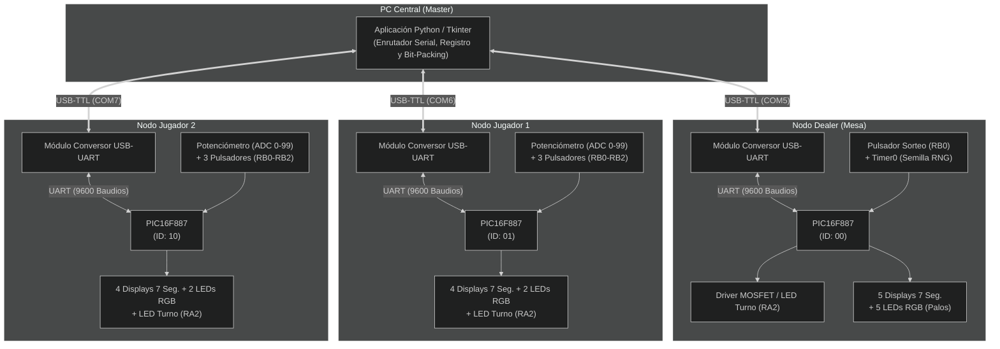
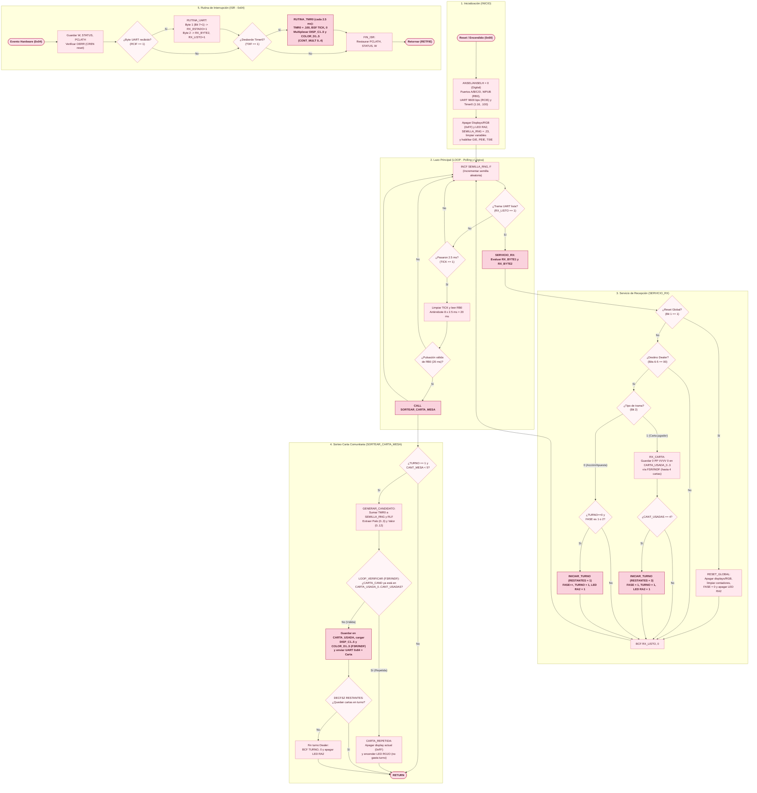
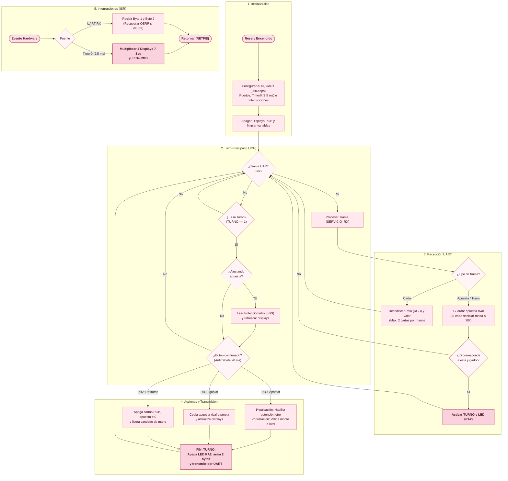

# Trabajo Final

**Electrónica Digital 2** — Facultad de Ciencias Exactas, Físicas y Naturales — Universidad Nacional de Córdoba

## 1. Requisitos

- Comunicación serie entre el microcontrolador y la PC.
- Interfaz de usuario.
- Protocolo de comunicación con el microcontrolador, documentado en este README.
- Un sensor, de los vistos en clase.
- Un actuador, de los vistos en clase.

## 2. Definition of Done (DoD) — Criterios de Aprobación de la Cátedra

Una historia de usuario se considera **"Done" (Finalizada y Aprobada)** cuando el Scrum Master (Ayudante) y el Product Owner (Docente) verifican los siguientes puntos:

1. **Uso de Ensamblador:** El código está escrito 100% en Ensamblador (`.asm`), compila sin errores ni *warnings* y genera el archivo `.hex`.
2. **Indicador de Turnos, Error, Ganador y Palo:** El sistema debe indicar al usuario mediante su interfaz su turno, quién fue el ganador, el palo de las cartas y si se generó algún error.
3. **Generación Aleatoria:** Las cartas deben ser distribuidas y generadas de forma 100% aleatoria, garantizando la imparcialidad del Dealer y llevando a un juego justo.
4. **Igualdad de Apuestas:** Los montos de las apuestas deben ser iguales; no se debe avanzar a la siguiente ronda con montos diferentes.
5. **Tiempo entre Turnos Aceptable:** El tiempo de juego y reparto debe ser aceptable, manteniendo la comunicación serie lo más optimizada posible; para jugar el turno no se debe esperar más de 7 segundos.
6. **Presentación del Hardware y Funcionamiento Correcto:** El prototipo montado no debe presentar obstrucciones visuales a los indicadores, debe presentar una disposición ordenada y cables sin enredos; no se aceptará un hardware que deba utilizar "mañas" para que funcione.

> El alcance y los detalles de cada trabajo se acuerdan con el docente de cada comisión.

---

## Trabajo Final — Electrónica Digital 2

### 1. Introducción y Objetivo del Proyecto

La **Mesa de Póker** es un sistema de pseudo-automatización de una partida tradicional de póker (*Texas Hold'em*) mediante una arquitectura distribuida multinodo para el control de turnos, apuestas, reparto de cartas privadas y generación aleatoria de cartas comunitarias en mesa.

El objetivo del proyecto es interconectar los **3 nodos físicos** (Dealer, Jugador 1 y Jugador 2) con una aplicación central en PC para ejecutar una partida completa de póker, manteniendo un registro visual y en tiempo real de cada evento, apuesta y carta jugada.

---

### 2. Marco Conceptual y Principios de Funcionamiento

#### 2.1. Principio Básico

El sistema se divide en tres nodos físicos independientes basados en microcontroladores **PIC16F887** (Dealer, Jugador 1 y Jugador 2) interconectados a una computadora central mediante conversores **USB-UART (9600 bps, 8N1)**. La comunicación opera bajo un **protocolo binario sincronizado de 2 bytes**:

* **Byte 1 (Cabecera de Control):** Contiene el bit de sincronismo (`S = 1`), los 2 bits de turno/destino (`T1 T0`: `00` Dealer, `01` Jugador 1, `10` Jugador 2), los 2 bits de estado/acción (`E1 E0`: Pasar, Apostar, Bajarse, Igualar), el bit de condición (`Co`) y el bit de reinicio global (`RST`).
* **Byte 2 (Carga Útil):** Transporta el monto de la apuesta (`0` a `99`) cuando es una trama de acción (`Co = 0`), o la codificación del **Palo (`0–3`)** y el **Valor de la carta (`0–12`: As, 2–10, J, Q, K)** cuando es una carta (`Co = 1`).

Toda la interfaz gráfica y la gestión del enrutamiento serial se implementan mediante un script en **Python 3** integrado con **Tkinter** y **PySerial**.

Al iniciar la partida desde el botón **Empezar** de la interfaz, se sortean y envían las cartas privadas a cada jugador y también al Dealer para registrarlas en su memoria anti-repetición. Con esa información cargada, el Dealer procede a "dar vuelta" las 3 primeras cartas comunitarias (*Flop*) mediante su pulsador físico (`RB0`), y tras cada ronda de apuestas igualadas habilita una nueva carta hasta completar la 5.ª (*Turn* y *River*).

#### 2.2. Arquitectura de Control

El flujo de operación se resume en tres etapas:

* **Inicio y Reparto Privado:** Al comenzar la partida desde la interfaz en Python, se sortean y envían vía UART (9600 bps) dos cartas únicas a cada nodo jugador, quienes las almacenan en RAM y las muestran localmente en sus displays de 7 segmentos y LEDs RGB.
* **Cartas Comunitarias (Nodo Dealer):** Mediante interrupciones de `TMR0` (multiplexado cada 2.5 ms y semilla pseudoaleatoria) y un pulsador en `RB0` con antirrebote por software (20 ms) y memoria anti-repetición en RAM, el Dealer genera y visualiza las 5 cartas de la mesa (3 en el *Flop*, 1 en el *Turn* y 1 en el *River*) en sus displays y LEDs RGB. Cada carta se envía a la PC para registrarse en pantalla.
* **Apuestas, Turnos y Reinicio:** Los jugadores ajustan su monto con el potenciómetro (ADC) y envían sus decisiones (*Pasar*, *Apostar*, *Bajarse* o *Igualar*) mediante tramas de 2 bytes hacia Python. La PC actualiza el pozo, gestiona el ida y vuelta de resubidas (*re-raise*) entre J1 y J2 hasta igualar los montos y, al cerrar la ronda, notifica al Dealer para habilitar la siguiente carta. El botón **Reiniciar** envía una trama global (`0x82 0x00`) que limpia los tres nodos para una nueva mano.

---

### 3. Componentes de Hardware y Software

* **Microcontroladores:** 3 × **PIC16F887** (1 para el nodo Dealer y 2 para los nodos Jugadores).
* **Visualización:** 13 displays de 7 segmentos de ánodo común (5 en el Dealer para las cartas comunitarias y 4 en cada Jugador: 2 para sus cartas privadas y 2 para el monto de apuesta).
* **Señalización:** 9 LEDs RGB de ánodo común (5 en el Dealer y 2 en cada Jugador) para identificar los palos de la baraja, más 3 LEDs indicadores de turno (1 por nodo).
* **Etapa de Potencia:** 13 transistores PNP para el multiplexado de dígitos (5 en el Dealer y 4 en cada Jugador).
* **Reloj y Desacoplo:** 3 cristales de cuarzo de 4 MHz y 6 capacitores cerámicos de 22 pF (2 por microcontrolador).
* **Entradas y Resistencias:** Pulsadores para reset (`MCLR`), sorteo y acciones de apuesta, junto con resistencias de $10\text{ k}\Omega$, $1\text{ k}\Omega$ y $220\ \Omega$ (limitadoras de segmentos y LEDs).
* **Actuador:** LED indicador de turno activo en el Dealer manejado mediante etapa de conmutación con **MOSFET** (y LEDs indicadores en `RA2`).
* **Sensor:** 1 potenciómetro lineal conectado al canal analógico `AN0` (`RA0`) por cada jugador para seleccionar el monto de apuesta (`00` a `99`).
* **Comunicación:** 3 módulos conversores USB-UART TTL para la conexión serial con la PC.
* **Montaje:** 3 protoboards, cables de interconexión y fuente de alimentación regulada de $5\text{ V}$.
* **Software y Lenguajes:** MPLAB X IDE / MPASM (programación en Assembler), Proteus 8 (simulación circuital), PAGE (diseño de interfaz Tkinter) y Python 3 con las librerías `tkinter` y `pyserial`.

#### Diagrama de Bloques General



<p align="center">
	
</p>
<p align="center">
	
</p>
<p align="center">
	
</p>

---

### 4. Codificación Visual de Cartas y Hardware

#### 4.1. Cuadro de Colores RGB por Palo de la Baraja

Cada LED RGB (ánodo común, activo en nivel bajo `0`) representa uno de los cuatro palos de la baraja francesa tanto en la interfaz de Python como en los nodos físicos:

| Código (`P1 P0`) | Decimal | Palo de Póker | Color del LED RGB | Pines Dealer (`RB3:B, RB2:G, RB1:R`) | Pines Jugadores (`RE2:B, RE1:G, RE0:R`) |
| :---: | :---: | :---: | :---: | :---: | :---: |
| `00` | `0` | **Corazón ($\heartsuit$)** | **Rojo** | `RB1 = 0` (`b'11111101'`) | `RE0 = 0` (`b'11111110'`) |
| `01` | `1` | **Trébol ($\clubsuit$)** | **Verde** | `RB2 = 0` (`b'11111011'`) | `RE1 = 0` (`b'11111101'`) |
| `10` | `2` | **Diamante ($\diamondsuit$)** | **Azul** | `RB3 = 0` (`b'11110111'`) | `RE2 = 0` (`b'11111011'`) |
| `11` | `3` | **Picas ($\spadesuit$)** | **Amarillo** (R + G) | `RB1 = 0, RB2 = 0` (`b'11111001'`) | `RE0 = 0, RE1 = 0` (`b'11111100'`) |

> **Nota de diagnóstico en el Dealer:** Si durante el sorteo aleatorio interno el PIC genera una carta que ya se encuentra registrada en la mesa o en la mano de algún jugador (`CARTA_REPETIDA`), el display correspondiente permanece apagado (`0xFF`) y su LED RGB se enciende en **Rojo** sin consumir el turno, permitiendo volver a presionar `RB0` para sortear una carta válida.

#### 4.2. Tabla de Valores de Cartas (`C3..C0`)

| Código (`C3..C0`) | Decimal | Carta | Carácter en Display 7-Seg | Código 7-Seg (Ánodo Común) |
| :---: | :---: | :---: | :---: | :---: |
| `0000` | `0` | **As** | `A` | `b'10001000'` |
| `0001` | `1` | **2** | `2` | `b'10100100'` |
| `0010` | `2` | **3** | `3` | `b'10110000'` |
| `0011` | `3` | **4** | `4` | `b'10011001'` |
| `0100` | `4` | **5** | `5` | `b'10010010'` |
| `0101` | `5` | **6** | `6` | `b'10000010'` |
| `0110` | `6` | **7** | `7` | `b'11111000'` |
| `0111` | `7` | **8** | `8` | `b'10000000'` |
| `1000` | `8` | **9** | `9` | `b'10010000'` |
| `1001` | `9` | **10** | `1` (representa 10) | `b'11111001'` |
| `1010` | `10` | **Jota** | `J` | `b'11100001'` |
| `1011` | `11` | **Reina** | `Q` | `b'01000000'` |
| `1100` | `12` | **Rey** | `K` | `b'10001001'` |

#### 4.3. Asignación de Pines de los Microcontroladores (PIC16F887)

| Pin / Puerto | Función en Nodo Dealer | Función en Nodos Jugador 1 y Jugador 2 |
| :--- | :--- | :--- |
| **`RA0 / AN0`** | No utilizado | Entrada analógica del **Potenciómetro** (apuesta `00–99`) |
| **`RA2`** | Salida **LED indicador de turno** (etapa MOSFET) | Salida **LED indicador de turno** activo |
| **`RB0`** | Entrada **Pulsador de sorteo** (con pull-up interno) | Entrada **Pulsador Apostar / Confirmar** (con pull-up) |
| **`RB1`** | Salida LED RGB — Canal **Rojo (R)** | Entrada **Pulsador Igualar / Pasar** (con pull-up) |
| **`RB2`** | Salida LED RGB — Canal **Verde (G)** | Entrada **Pulsador Retirarse / Fold** (con pull-up) |
| **`RB3`** | Salida LED RGB — Canal **Azul (B)** | No utilizado |
| **`RC0 – RC4`** | Habilitación displays `1` a `5` (Cartas comunitarias) | Habilitación displays `1` a `4` (`RC0–RC1` cartas, `RC2–RC3` apuesta) |
| **`RC6 / TX`** | Transmisión serial UART (9600 bps) hacia PC | Transmisión serial UART (9600 bps) hacia PC |
| **`RC7 / RX`** | Recepción serial UART (9600 bps) desde PC | Recepción serial UART (9600 bps) desde PC |
| **`RD0 – RD7`** | Bus de segmentos (`a–g, dp`) de displays 7-seg | Bus de segmentos (`a–g, dp`) de displays 7-seg |
| **`RE0 – RE2`** | No utilizado | Salidas LED RGB de cartas (`RE0:R`, `RE1:G`, `RE2:B`) |

---

### 5. Comunicación en Serie

Para la comunicación serial del proyecto se diseñó un **protocolo binario de longitud fija de 2 bytes (doble trama)** a **9600 baudios (8N1)**, optimizando el intercambio de datos y la sincronización entre los tres microcontroladores PIC16F887 y la aplicación central en Python. Dado que el script en Python actúa como enrutador entre múltiples nodos, estandarizar que toda transmisión conste siempre de un paquete de 2 bytes evita desfasajes en la lectura de los búferes UART.

#### 5.1. Organización de la Trama

**Byte 1 (Cabecera de Control):**

| Bit 7 | Bit 6 | Bit 5 | Bit 4 | Bit 3 | Bit 2 | Bit 1 | Bit 0 |
| :---: | :---: | :---: | :---: | :---: | :---: | :---: | :---: |
| `S` | `T1` | `T0` | `E1` | `E0` | `Co` | `RST` | `L` |

* **Bit 7 — Sync (`S = 1`):** Siempre en `1` (máscara `0x80`). Indica el inicio válido de la trama para sincronizar la interrupción UART de los PICs.
* **Bits 6–5 — Turno / Destino (`T1 T0`):** Identifica el nodo destinatario o turno activo.
* **Bits 4–3 — Estado / Acción (`E1 E0`):** Indica la jugada o acción realizada por el jugador.
* **Bit 2 — Condición (`Co`):** Define el formato del Byte 2. Si es `0`, el Byte 2 trae una **apuesta**; si es `1`, trae una **carta**.
* **Bit 1 — Reset Global (`RST`):** Cuando vale `1` (`0x82 0x00`), ordena el reinicio simultáneo de los 3 microcontroladores.
* **Bit 0 — Libre (`L`):** Reservado (`0`).

**Tabla de Codificación de Turnos (`T1 T0`) y Estados (`E1 E0`):**

| Bits Turno (`T1 T0`) | Nodo Destinatario | Bits Estado (`E1 E0`) | Acción / Jugada |
| :---: | :--- | :---: | :--- |
| `00` | **Dealer** (Mesa) | `00` | **Pasar** (*Check* / apuesta `$0`) |
| `01` | **Jugador 1** | `01` | **Apostar / Subir** (*Bet / Raise*) |
| `10` | **Jugador 2** | `10` | **Retirarse / Bajarse** (*Fold*) |
| `11` | Reservado | `11` | **Igualar** (*Call*) |

---

**Byte 2 (Carga Útil):**

**Caso A — Trama de Carta (`Co = 1`):**

| Bit 7 | Bit 6 | Bit 5 | Bit 4 | Bit 3 | Bit 2 | Bit 1 | Bit 0 |
| :---: | :---: | :---: | :---: | :---: | :---: | :---: | :---: |
| `1` | `P1` | `P0` | `C3` | `C2` | `C1` | `C0` | `0` |

* **Bit 7 (`1`):** Confirma que el paquete contiene datos de carta (coincide con `Co = 1`).
* **Bits 6–5 — Palo (`P1 P0`):** Palo de la carta (`00` = Corazón/Rojo, `01` = Trébol/Verde, `10` = Diamante/Azul, `11` = Picas/Amarillo).
* **Bits 4–1 — Número (`C3..C0`):** Valor numérico de la carta en 4 bits, desde `0` (As) hasta `12` (Rey).
* **Bit 0 (`0`):** Bit libre.

**Caso B — Trama de Apuesta (`Co = 0`):**

| Bit 7 | Bit 6 | Bit 5 | Bit 4 | Bit 3 | Bit 2 | Bit 1 | Bit 0 |
| :---: | :---: | :---: | :---: | :---: | :---: | :---: | :---: |
| `0` | `A6` | `A5` | `A4` | `A3` | `A2` | `A1` | `A0` |

* **Bit 7 (`0`):** Confirma que el paquete contiene un monto de apuesta (coincide con `Co = 0`).
* **Bits 6–0 — Monto de Apuesta (`A6..A0`):** Valor entero sin signo de 7 bits (rango operativo de `0` a `99`) proveniente del potenciómetro (ADC) o de la apuesta vigente.

#### 5.2. Ejemplos de Tramas del Protocolo

| Evento / Operación | Byte 1 (Hex) | Byte 2 (Hex) | Desglose Binario | Descripción |
| :--- | :---: | :---: | :---: | :--- |
| **Reset Global** | `0x82` | `0x00` | `10000010 \| 00000000` | Reinicia displays, LEDs y contadores en todos los PICs. |
| **Reparto carta a J1** | `0xA4` | `0x9A` | `10100100 \| 10011010` | Destino J1 (`01`), Carta (`Co=1`), Palo `00` (Rojo), Valor `13` (`K`). |
| **Carta comunitaria Dealer** | `0x84` | `0xA0` | `10000100 \| 10100000` | Origen Dealer (`00`), Carta (`Co=1`), Palo `01` (Verde), Valor `0` (`As`). |
| **Habilitar turno a J1 ($0)** | `0xA0` | `0x00` | `10100000 \| 00000000` | Destino J1 (`01`), Acción (`Co=0`), Estado Pasar (`00`), Monto `$0`. |
| **J1 apuesta $25 a J2** | `0xC8` | `0x19` | `11001000 \| 00011001` | Destino J2 (`10`), Acción (`Co=0`), Estado Apostar (`01`), Monto `$25`. |
| **J2 iguala y cierra ronda** | `0x98` | `0x00` | `10011000 \| 00000000` | Destino Dealer (`00`), Acción (`Co=0`), Estado Igualar (`11`), Monto `$0`. |
| **Jugador se retira (Fold)** | `0x90` | `0x00` | `10010000 \| 00000000` | Destino Dealer (`00`), Acción (`Co=0`), Estado Bajarse (`10`), Monto `$0`. |

---

### 6. Guía de Ejecución y Puesta en Marcha

1. **Conexión de Hardware:** Conectar los tres nodos (Dealer, Jugador 1 y Jugador 2) a la PC mediante sus respectivos conversores USB-TTL y alimentar las protoboards con $5\text{ V}$.
2. **Verificación de Puertos COM:** Comprobar en el Administrador de Dispositivos de Windows los puertos asignados y verificar que coincidan con las constantes en `poker_master.py`:
   ```python
   PUERTO_DEALER = 'COM5'
   PUERTO_J1     = 'COM6'
   PUERTO_J2     = 'COM7'
   ```
3. **Ejecución de la Interfaz:** Ejecutar el archivo principal desde la terminal:
   ```bash
   python interfaz.py
   ```
4. **Flujo de Partida:**
   * Ingresar los nombres de los jugadores y presionar **Empezar** para repartir las cartas iniciales.
   * Presionar 3 veces el pulsador `RB0` en el **Dealer** para descubrir el *Flop* (3 cartas comunitarias).
   * Cuando se encienda el LED de turno (`RA2`) en el **Jugador 1**, operar los pulsadores:
     * **`RB0` (1.ª vez):** Habilita el potenciómetro para elegir monto en los displays.
     * **`RB0` (2.ª vez):** Confirma la apuesta (debe ser estrictamente mayor a la del rival).
     * **`RB1`:** Iguala la apuesta vigente (o pasa en `$0`).
     * **`RB2`:** Se retira de la mano (*Fold*).
   * Repetir las rondas de apuestas para el *Turn* (4.ª carta) y el *River* (5.ª carta), y utilizar **Reiniciar** para comenzar una nueva partida.

---

### 7. Detalle Técnico por Módulo

<details>
<summary><h3>Dealer</h3></summary>

<blockquote>

<details>
<summary>Diagrama de flujo del Dealer</summary>



</details>

<details>
<summary>Esquemas e imágenes del Dealer</summary>


<p align="center">
	
</p>

</details>

<details>
<summary>Código del Dealer (.asm)</summary>

```asm
LIST P=16F887
    #include <p16f887.inc>
    ERRORLEVEL -302
    ERRORLEVEL -305

    __CONFIG _CONFIG1, _FOSC_XT & _WDTE_OFF & _PWRTE_OFF & _MCLRE_ON & _CP_OFF & _CPD_OFF & _BOREN_ON & _IESO_OFF & _FCMEN_OFF & _LVP_OFF
    __CONFIG _CONFIG2, _BOR4V_BOR40V & _WRT_OFF

;-------------------------------------------------------------------------------
; VARIABLES (Banco 0)
;-------------------------------------------------------------------------------
CBLOCK  0x20
    ; Cartas de jugador y dealer
    CARTA_USADA_0
    CARTA_USADA_1
    CARTA_USADA_2
    CARTA_USADA_3
    CARTA_USADA_4
    CARTA_USADA_5
    CARTA_USADA_6
    CARTA_USADA_7
    CARTA_USADA_8

    ; Cartas en display
    DISP_C1
    DISP_C2
    DISP_C3
    DISP_C4
    DISP_C5

    ; Palos, led rgb
    COLOR_D1
    COLOR_D2
    COLOR_D3
    COLOR_D4
    COLOR_D5

    ; Multiplexado, boton y aleatorio
    CONT_MULT       ; 0..4
    TICK            ; bandera de 2.5 ms
    CONT_REB        ; anti rebote 
    BTN_ACT         ; estado boton
    BTN_ULT         ; estado boton antes
    SEMILLA_RNG     ; contador aleatorio
    CARTA_CAND      ; valor y palo de la carta guardada como la recive de uart
    INDICE_VERIF    ; indice comparador
    CANT_USADAS     ; cantidad de cartas total
    CANT_MESA       ; cantidad de cartas sacadas por dealer
    BYTE_AUX        ; variable auxiliar
    INDICE_PALO     
    INDICE_CARTA    

    ; Turnos del dealer
    TURNO           ; bit0 = 1: el dealer puede dar vuelta cartas
    FASE            ; turnos iniciados: 0 = esperando las 4 cartas, 1..3
    RESTANTES       ; cartas que aun puede dar vuelta en el turno actual

    ; Recepcion UART
    RX_ESTADO       ; 0 = espera Byte 1, 1 = espera Byte 2
    RX_BYTE1
    RX_BYTE2
    RX_LISTO        ; 1 = trama completa lista
ENDC

CBLOCK  0x70
    W_TEMP
    STATUS_TEMP
    PCLATH_TEMP
ENDC

;-------------------------------------------------------------------------------
; VECTORES
;-------------------------------------------------------------------------------
    ORG 0x00
    GOTO INICIO

    ORG 0x04
    GOTO ISR

;----------------------------
; TABLAS
;----------------------------
TABLA_CARTAS:
    ADDWF PCL, F
    RETLW b'10001000' ; 0: A
    RETLW b'10100100' ; 1: 2
    RETLW b'10110000' ; 2: 3
    RETLW b'10011001' ; 3: 4
    RETLW b'10010010' ; 4: 5
    RETLW b'10000010' ; 5: 6
    RETLW b'11111000' ; 6: 7
    RETLW b'10000000' ; 7: 8
    RETLW b'10010000' ; 8: 9
    RETLW b'11111001' ; 9: 10 (se muestra "1")
    RETLW b'11100001' ; 10: J
    RETLW b'01000000' ; 11: Q
    RETLW b'10001001' ; 12: K

;----------------------------    
    
TABLA_PALOS:                 
    ADDWF PCL, F
    RETLW b'11111101' ; 00 = ROJO
    RETLW b'11111011' ; 01 = VERDE
    RETLW b'11110111' ; 10 = AZUL
    RETLW b'11111001' ; 11 = AMARILLO 

;----------------------------
    
SELECCION_D7S:
    ADDWF PCL, F
    RETLW b'11111110' ; RC0 -> carta 1
    RETLW b'11111101' ; RC1 -> carta 2
    RETLW b'11111011' ; RC2 -> carta 3
    RETLW b'11110111' ; RC3 -> carta 4 
    RETLW b'11101111' ; RC4 -> carta 5 

;----------------------------
; Incio
;----------------------------
    
INICIO:
    ; salida digital
    BANKSEL ANSEL
    CLRF ANSEL
    
    BANKSEL ANSELH
    CLRF ANSELH

    ; Puertos
    BANKSEL TRISD
    CLRF TRISD                  ; segmentos
    
    BANKSEL TRISC
    MOVLW b'10000000'           ; RC0-RC4 selecciones, RC6 TX, RC7 RX
    MOVWF TRISC
    
    BANKSEL TRISB
    MOVLW b'00000001'           ; RB0 boton, RB1-RB3 RGB
    MOVWF TRISB
    
    BANKSEL TRISA
    MOVLW b'11111011'           ; RA2 salida (LED de turno)
    MOVWF TRISA
    BCF OPTION_REG, 7           ; pull-ups habilitados
    
    BANKSEL WPUB
    MOVLW b'00000001'           ; pull-up en RB0
    MOVWF WPUB

    ; UART 9600 baudios (BRGH=1, BRG16=1, SPBRG=103)
    BANKSEL TXSTA
    MOVLW b'00100110'           ; TXEN, BRGH
    MOVWF TXSTA
    
    BANKSEL BAUDCTL
    MOVLW b'00001000'           ; BRG16
    MOVWF BAUDCTL
    
    BANKSEL SPBRG
    MOVLW .103
    MOVWF SPBRG
    
    BANKSEL SPBRGH
    CLRF SPBRGH
    
    BANKSEL PIE1
    MOVLW b'00100000'           ; RCIE
    MOVWF PIE1
    
    BANKSEL RCSTA
    MOVLW b'10010000'           ; SPEN, CREN
    MOVWF RCSTA

    ; Estado inicial
    MOVLW 0xFF
    MOVWF PORTC                 ; displays apagados
    MOVWF PORTD
    MOVWF PORTB                 ; RGB apagados
    MOVWF DISP_C1
    MOVWF DISP_C2
    MOVWF DISP_C3
    MOVWF DISP_C4
    MOVWF DISP_C5
    MOVWF COLOR_D1
    MOVWF COLOR_D2
    MOVWF COLOR_D3
    MOVWF COLOR_D4
    MOVWF COLOR_D5
    BCF PORTA, 2                ; LED de turno apagado

    CLRF CONT_MULT
    CLRF TICK
    CLRF CONT_REB
    MOVLW b'00000001'
    MOVWF BTN_ULT
    MOVLW .23
    MOVWF SEMILLA_RNG
    CLRF CANT_USADAS
    CLRF CANT_MESA
    CLRF TURNO
    CLRF FASE
    CLRF RESTANTES
    CLRF RX_ESTADO
    CLRF RX_BYTE1
    CLRF RX_BYTE2
    CLRF RX_LISTO

    ; Timer0: 1:16, TMR0 = 100 -> 2.5 ms
    BANKSEL OPTION_REG
    MOVLW b'00000011'
    MOVWF OPTION_REG
    
    BANKSEL TMR0
    MOVLW .100
    MOVWF TMR0
    BCF INTCON, T0IF
    BSF INTCON, T0IE
    BSF INTCON, PEIE
    BSF INTCON, GIE

;----------------------------
; LOOP principal
;----------------------------
LOOP: ;revisa boton por polling
    BCF STATUS, RP0
    BCF STATUS, RP1

    INCF SEMILLA_RNG, F         ; semilla aleatoria

    BTFSC RX_LISTO, 0           ; ¿trama completa?
    GOTO SERVICIO_RX

    BTFSS TICK, 0               ; boton: muestreo cada 2.5 ms
    GOTO LOOP
    BCF TICK, 0

    MOVF PORTB, W
    ANDLW b'00000001'           ; RB0
    MOVWF BTN_ACT
    XORLW b'00000001'
    BTFSC STATUS, Z             ; suelto
    GOTO REB_SUELTO

    MOVF BTN_ACT, W
    XORWF BTN_ULT, W
    BTFSS STATUS, Z             ; cambio
    GOTO REB_CAMBIO

    MOVLW .8
    SUBWF CONT_REB, W
    BTFSC STATUS, C             ; pulsacion ya atendida
    GOTO LOOP
   
    INCF CONT_REB, F
    MOVLW .8
    XORWF CONT_REB, W
    BTFSS STATUS, Z             
    GOTO LOOP

    CALL SORTEAR_CARTA_MESA     ; pulsacion valida
    GOTO LOOP

REB_SUELTO:
    CLRF CONT_REB
    MOVLW b'00000001'
    MOVWF BTN_ULT
    GOTO LOOP

REB_CAMBIO:
    MOVF BTN_ACT, W
    MOVWF BTN_ULT
    CLRF CONT_REB
    GOTO LOOP

;----------------------------
; Recepcion de datos
;----------------------------
    
SERVICIO_RX:
    
    BTFSC RX_BYTE1, 1           ; reset global
    GOTO RESET_GLOBAL
    
    MOVF RX_BYTE1, W
    ANDLW b'01100000'
    BTFSS STATUS, Z             ; enmascarado, revisa turno de dealer
    GOTO FIN_RX
    
    BTFSC RX_BYTE1, 2           ; bit 2 = 1: revisa si es carta
    GOTO RX_CARTA
    GOTO RX_ACCION              ; bit 2 = 0: si es apuesta se va

;--- Reset global  ---------------------------

RESET_GLOBAL:
    
    MOVLW 0xFF
    MOVWF DISP_C1
    MOVWF DISP_C2
    MOVWF DISP_C3
    MOVWF DISP_C4
    MOVWF DISP_C5
    MOVWF COLOR_D1
    MOVWF COLOR_D2
    MOVWF COLOR_D3
    MOVWF COLOR_D4
    MOVWF COLOR_D5
    CLRF CANT_USADAS
    CLRF CANT_MESA
    CLRF TURNO
    CLRF FASE
    CLRF RESTANTES
    CLRF CONT_REB
    BCF PORTA, 2                ; LED de turno apagado
    GOTO FIN_RX

;--- Carta de jugador para la memoria anti-repeticion -------------------------

RX_CARTA:
    
    MOVLW .4
    SUBWF CANT_USADAS, W
    BTFSC STATUS, C             ; revisa que ya se hayan cargado las cartas de jugadores
    GOTO FIN_RX

    MOVLW CARTA_USADA_0
    ADDWF CANT_USADAS, W
    MOVWF FSR
    MOVF RX_BYTE2, W
    ANDLW b'01111110'           ; limpia todo y guarda 01111110 enmascarado
    MOVWF INDF
    INCF CANT_USADAS, F

    MOVLW .4
    XORWF CANT_USADAS, W
    BTFSS STATUS, Z             ; revisa si faltan cartas
    GOTO FIN_RX
    
    MOVLW .3                    
    CALL INICIAR_TURNO
    GOTO FIN_RX

;--- el turno pasa al dealer -------------------
RX_ACCION:
    BTFSC TURNO, 0              ; ya esta en turno
    GOTO FIN_RX
    
    MOVF FASE, W
    BTFSC STATUS, Z             ; FASE 0: faltan las 4 cartas
    GOTO FIN_RX
    
    SUBLW .3
    BTFSC STATUS, Z             ; FASE 3: ya se jugaron los 3 turnos
    GOTO FIN_RX
    
    MOVLW .1                    ; TURNO 2 o TURNO 3: 1 carta
    CALL INICIAR_TURNO
    GOTO FIN_RX

FIN_RX:
    BCF RX_LISTO, 0
    GOTO LOOP

;----------------------------
;Subrutinas
;----------------------------

INICIAR_TURNO:
    
    MOVWF RESTANTES
    INCF FASE, F
    BSF TURNO, 0
    BSF PORTA, 2                ; LED de turno encendido
    RETURN

;----------------------------

SORTEAR_CARTA_MESA:
    
    BTFSS TURNO, 0              ; revisa que sea turno del dealer
    RETURN
    
    MOVLW .5
    SUBWF CANT_MESA, W
    BTFSC STATUS, C             ; revisa si ya estan las 5 cartas del dealer
    RETURN

;----------------------------
    
GENERAR_CANDIDATO:
    
    MOVF TMR0, W
    ADDWF SEMILLA_RNG, F
    RLF SEMILLA_RNG, F

    MOVF SEMILLA_RNG, W         ; palo (0..3)
    ANDLW b'00000011'
    MOVWF INDICE_PALO

    SWAPF SEMILLA_RNG, W        ; valor (0..12), rechaza >= 13
    ANDLW b'00001111'
    MOVWF INDICE_CARTA
    MOVLW .13
    SUBWF INDICE_CARTA, W
    
    BTFSC STATUS, C
    GOTO GENERAR_CANDIDATO

    MOVF INDICE_PALO, W         ; acomoda el bit como se va a tener que enviar
    MOVWF BYTE_AUX
    BCF STATUS, C
    RLF BYTE_AUX, F
    RLF BYTE_AUX, F
    RLF BYTE_AUX, F
    RLF BYTE_AUX, F
    RLF BYTE_AUX, F
    BCF STATUS, C
    RLF INDICE_CARTA, W
    IORWF BYTE_AUX, W
    MOVWF CARTA_CAND

    MOVF CANT_USADAS, F         ; anti-repeticion
    BTFSC STATUS, Z
    GOTO CARTA_VALIDA
    
    CLRF INDICE_VERIF
    BCF STATUS, IRP

LOOP_VERIFICAR: ;revisa si la carta esta repetida, prende rojo
    
    MOVLW CARTA_USADA_0
    ADDWF INDICE_VERIF, W
    MOVWF FSR
    MOVF INDF, W
    XORWF CARTA_CAND, W
    
    BTFSC STATUS, Z             ; Z=1 -> carta repetida
    GOTO CARTA_REPETIDA
    INCF INDICE_VERIF, F
    MOVF CANT_USADAS, W
    XORWF INDICE_VERIF, W
    
    BTFSS STATUS, Z
    GOTO LOOP_VERIFICAR

CARTA_VALIDA:
    
    MOVLW CARTA_USADA_0         ; registra la carta
    ADDWF CANT_USADAS, W
    MOVWF FSR
    BCF STATUS, IRP
    MOVF CARTA_CAND, W
    MOVWF INDF
    INCF CANT_USADAS, F

    MOVF INDICE_CARTA, W        ; digito en su display
    CALL TABLA_CARTAS
    MOVWF BYTE_AUX
    MOVLW DISP_C1
    ADDWF CANT_MESA, W
    MOVWF FSR
    MOVF BYTE_AUX, W
    MOVWF INDF

    MOVF INDICE_PALO, W         ; color RGB
    CALL TABLA_PALOS
    MOVWF BYTE_AUX
    MOVLW COLOR_D1
    ADDWF CANT_MESA, W
    MOVWF FSR
    MOVF BYTE_AUX, W
    MOVWF INDF

    INCF CANT_MESA, F


    BANKSEL PIR1
ESP_TX1:
    
    BTFSS PIR1, TXIF
    GOTO ESP_TX1
    MOVLW b'10000100'           ; 0x84: sync, dest dealer, carta
    MOVWF TXREG
    
ESP_TX2:
    
    BTFSS PIR1, TXIF
    GOTO ESP_TX2
    MOVF CARTA_CAND, W
    IORLW b'10000000'
    MOVWF TXREG

    BCF STATUS, RP0
    BCF STATUS, RP1

    DECFSZ RESTANTES, F         ; ¿quedan cartas en este turno?
    RETURN
    
    ; Dealer termino su turno.
    BCF TURNO, 0                ; fin del turno del dealer
    BCF PORTA, 2                ; LED de turno apagado
    RETURN

;----------------------------

;--- Si la carta esta repetida, enciende en rojo el led en la posicion respectiva. 
    ;No gasta el contador de pulsaciones --------
CARTA_REPETIDA:
    
    MOVLW DISP_C1
    ADDWF CANT_MESA, W
    MOVWF FSR
    
    BCF STATUS, IRP
    MOVLW 0xFF
    MOVWF INDF                  ; display apagado: solo se ve el LED
    MOVLW .0                    ; palo 0 = ROJO
    CALL TABLA_PALOS
    MOVWF BYTE_AUX
    MOVLW COLOR_D1
    ADDWF CANT_MESA, W
    MOVWF FSR
    MOVF BYTE_AUX, W
    MOVWF INDF                  ; LED rojo en esa posicion
    RETURN

;----------------------------
; INTERRUPCION
;----------------------------
ISR:
    
    MOVWF W_TEMP
    SWAPF STATUS, W
    MOVWF STATUS_TEMP
    MOVF PCLATH, W
    MOVWF PCLATH_TEMP
    CLRF PCLATH

    BCF STATUS, RP0
    BCF STATUS, RP1

    BTFSC RCSTA, OERR
    CALL RECUPERAR_OERR
    BTFSC PIR1, RCIF
    CALL RUTINA_UART

    BTFSS INTCON, T0IF
    GOTO FIN_ISR

RUTINA_TMR0:
    
    BCF INTCON, T0IF
    MOVLW .100
    MOVWF TMR0
    BSF TICK, 0

    MOVLW 0xFF                  ; apaga displays y RGB (anti-fantasma)
    MOVWF PORTC
    MOVWF PORTB

; multiplaxa
    
    MOVF CONT_MULT, W
    BTFSC STATUS, Z
    GOTO M_DISP1
    XORLW .1
    BTFSC STATUS, Z
    GOTO M_DISP2
    MOVF CONT_MULT, W
    XORLW .2
    BTFSC STATUS, Z
    GOTO M_DISP3
    MOVF CONT_MULT, W
    XORLW .3
    BTFSC STATUS, Z
    GOTO M_DISP4

M_DISP5:
   
    MOVF COLOR_D5, W
    MOVWF PORTB
    MOVF DISP_C5, W
    GOTO CARGAR_DISP

M_DISP1:
    
    MOVF COLOR_D1, W
    MOVWF PORTB
    MOVF DISP_C1, W
    GOTO CARGAR_DISP

M_DISP2:
    
    MOVF COLOR_D2, W
    MOVWF PORTB
    MOVF DISP_C2, W
    GOTO CARGAR_DISP

M_DISP3:
    
    MOVF COLOR_D3, W
    MOVWF PORTB
    MOVF DISP_C3, W
    GOTO CARGAR_DISP

M_DISP4:

    MOVF COLOR_D4, W
    MOVWF PORTB
    MOVF DISP_C4, W

CARGAR_DISP:
    
    MOVWF PORTD
    MOVF CONT_MULT, W
    CALL SELECCION_D7S
    MOVWF PORTC
    INCF CONT_MULT, F
    MOVF CONT_MULT, W
    XORLW .5
    BTFSC STATUS, Z
    CLRF CONT_MULT
    GOTO FIN_ISR

;--- Recepcion UART (2 bytes) --------------------------------------------------
RUTINA_UART:
    
    BTFSC RX_LISTO, 0           ; trama anterior sin atender: espera
    RETURN
    BTFSC RX_ESTADO, 0
    GOTO UART_BYTE2

UART_BYTE1:
    
    MOVF RCREG, W
    MOVWF RX_BYTE1
    BTFSS RX_BYTE1, 7           ; sincronismo
    GOTO CHECK_FIFO
    BSF RX_ESTADO, 0
    GOTO CHECK_FIFO
    
UART_BYTE2:
    
    MOVF RCREG, W
    MOVWF RX_BYTE2
    BSF RX_LISTO, 0
    BCF RX_ESTADO, 0
    RETURN

CHECK_FIFO:

    BTFSC PIR1, RCIF
    GOTO RUTINA_UART
    RETURN

RECUPERAR_OERR:

    BCF RCSTA, CREN
    BSF RCSTA, CREN
    CLRF RX_ESTADO
    RETURN

FIN_ISR:
    
    MOVF PCLATH_TEMP, W
    MOVWF PCLATH
    SWAPF STATUS_TEMP, W
    MOVWF STATUS
    SWAPF W_TEMP, F
    SWAPF W_TEMP, W
    RETFIE

    END
```

</details>

</blockquote>

</details>

<details>
<summary><h3>Jugadores</h3></summary>

<blockquote>

<details>
<summary>Diagrama de flujo de los Jugadores</summary>



</details>

<details>
<summary>Esquemas e imágenes de los Jugadores</summary>


<p align="center">
	
</p>

</details>

<details>
<summary>Código del Jugador (.asm)</summary>

```asm
LIST P=16F887
    #include <p16f887.inc>
    ERRORLEVEL -302
    ERRORLEVEL -305

; --- Bits de configuración ---
    __CONFIG _CONFIG1, _FOSC_XT & _WDTE_OFF & _PWRTE_OFF & _MCLRE_ON & _CP_OFF & _CPD_OFF & _BOREN_ON & _IESO_ON & _FCMEN_ON & _LVP_OFF
    __CONFIG _CONFIG2, _BOR4V_BOR40V & _WRT_OFF

;-----------------------------------------------------------------------------
; CONFIGURACIÓN MANUAL POR JUGADOR (Cambiar estos 2 valores para Jugador 2)
;-----------------------------------------------------------------------------
; --- Valores para JUGADOR 1 ---
ID_JUGADOR_MASK EQU  b'00100000'    ; 0x20 -> Turno entrante para J1 (Bits 6-5 = 01)
ID_TURNO        EQU  b'11000000'    ; 0xC0 -> Turno saliente hacia J2 (Bits 6-5 = 10)

; --- Valores para JUGADOR 2 (Descomentar estos y comentar los de arriba) ---
; ID_JUGADOR_MASK EQU  b'01000000'  ; 0x40 -> Turno entrante para J2 (Bits 6-5 = 10)
; ID_TURNO        EQU  b'10000000'  ; 0x80 -> Turno saliente hacia Dealer (Bits 6-5 = 00)

CBLOCK  0x20
    APUESTA_INF     ; unidades (RC3)
    APUESTA_SUP     ; decenas  (RC2)
    CARTA1          ; carta 1  (RC0)
    CARTA2          ; carta 2  (RC1)
    CONT_MULT
    APUESTA_J1
    APUESTA_J2
    TURNO
    TICK
    CONT_REB
    BTN_ACT
    BTN_ULT
    BYTE_DATO
    BYTE_APUESTA
    RX_ESTADO
    RX_BYTE1
    RX_BYTE2
    ADC_ALTO
    ADC_BAJO
    APUESTA_TEMP
    DECENA_APUESTA
    UNIDAD_APUESTA
    CONT_RECEPCION
    RX_LISTO
    INDICE_PALO
    COLOR_C1
    COLOR_C2
    INDICE_CARTA
    BYTE_AUX
    POTENCIOMETRO
    APUESTA_ESTADO
    RETIRADO        ; 1 = el jugador se bajó (no juega más hasta el reset)
ENDC

CBLOCK 0x70
    W_TEMP
    STATUS_TEMP
ENDC

    ORG 0x00
    GOTO INICIO

    ORG 0x04
    GOTO ISR

;-------------------------------------------------------------------------------
;                   TABLAS (Página 0)
;-------------------------------------------------------------------------------
TABLA_CARTAS
    ADDWF PCL, F
    RETLW b'10001000' ; 0: A
    RETLW b'10100100' ; 1: 2
    RETLW b'10110000' ; 2: 3
    RETLW b'10011001' ; 3: 4
    RETLW b'10010010' ; 4: 5
    RETLW b'10000010' ; 5: 6
    RETLW b'11111000' ; 6: 7
    RETLW b'10000000' ; 7: 8
    RETLW b'10010000' ; 8: 9
    RETLW b'11111001' ; 9: 10
    RETLW b'11100001' ; 10: J
    RETLW b'01000000' ; 11: Q
    RETLW b'10001001' ; 12: K

TABLA_PALOS
    ADDWF PCL, F
    RETLW b'11111110' ; 00 = ROJO     (RE0 = 0)
    RETLW b'11111101' ; 01 = VERDE    (RE1 = 0)
    RETLW b'11111011' ; 10 = AZUL     (RE2 = 0)
    RETLW b'11111100' ; 11 = AMARILLO (RE0=0, RE1=0)

SELECCION_D7S
    ADDWF PCL, F
    RETLW b'11111110' ; CONT_MULT 0 -> RC0 (carta 1)
    RETLW b'11111101' ; CONT_MULT 1 -> RC1 (carta 2)
    RETLW b'11111011' ; CONT_MULT 2 -> RC2 (decenas)
    RETLW b'11110111' ; CONT_MULT 3 -> RC3 (unidades)

TABLA_APUESTA
    ADDWF PCL, F
    RETLW b'11000000' ; 0
    RETLW b'11111001' ; 1
    RETLW b'10100100' ; 2
    RETLW b'10110000' ; 3
    RETLW b'10011001' ; 4
    RETLW b'10010010' ; 5
    RETLW b'10000010' ; 6
    RETLW b'11111000' ; 7
    RETLW b'10000000' ; 8
    RETLW b'10010000' ; 9

;===============================================================================
; INICIALIZACIÓN
;===============================================================================
INICIO
    BANKSEL ANSEL
    MOVLW b'00000001'       ; Solo RA0 (AN0) analógico; RE0-RE2 (AN5-AN7) digitales
    MOVWF ANSEL
    BANKSEL ANSELH
    CLRF ANSELH             ; Todo PORTB digital (incluye RB2/AN8)

    BANKSEL ADCON1
    MOVLW b'10000000'       ; Justificado a la derecha, Vref = VDD/VSS
    MOVWF ADCON1
    BANKSEL ADCON0
    MOVLW b'01000001'       ; AN0, Fosc/8, ADC ON
    MOVWF ADCON0
    BSF ADCON0, 1           ; Lanza primera conversión

    BANKSEL PIE1
    MOVLW b'00100000'       ; RCIE habilitado
    MOVWF PIE1
    MOVLW b'00100110'       ; TXEN=1, BRGH=1
    MOVWF TXSTA
    BANKSEL RCSTA
    MOVLW b'10010000'       ; SPEN=1, CREN=1
    MOVWF RCSTA
    BANKSEL BAUDCTL
    MOVLW b'00001000'       ; BRG16=1
    MOVWF BAUDCTL
    BANKSEL SPBRG
    MOVLW .103              ; 9600 baudios a 4 MHz
    MOVWF SPBRG
    BANKSEL SPBRGH
    CLRF SPBRGH

    BANKSEL TRISD
    CLRF TRISD              ; Segmentos 7-seg
    BANKSEL TRISC
    MOVLW b'10000000'       ; RC0-RC3 selección displays, RC7 RX, RC6 TX
    MOVWF TRISC
    MOVLW b'00000001'       ; RA0 pot, RA2 LED turno
    MOVWF TRISA
    CLRF TRISE              ; RE0-RE2 LEDs RGB
    MOVLW b'00000111'       ; RB0-RB2 entradas (botones)
    MOVWF TRISB
    BCF OPTION_REG, 7       ; Pull-ups internos habilitados
    BANKSEL WPUB
    MOVLW b'00000111'       ; Pull-ups en RB0, RB1 y RB2
    MOVWF WPUB

    BANKSEL PORTC
    MOVLW 0xFF
    MOVWF PORTC
    MOVWF PORTD
    MOVWF PORTE
    MOVWF COLOR_C1
    MOVWF COLOR_C2
    MOVWF CARTA1
    MOVWF CARTA2
    BCF PORTA, 2
    CLRF CONT_MULT
    CLRF PORTB
    CLRF APUESTA_J1
    CLRF APUESTA_J2
    MOVLW b'11000000'       ; "0"
    MOVWF APUESTA_SUP
    MOVWF APUESTA_INF
    CLRF TURNO
    CLRF TICK
    CLRF CONT_REB
    CLRF BYTE_APUESTA
    CLRF BYTE_DATO
    MOVLW b'00000111'
    MOVWF BTN_ULT
    CLRF RX_ESTADO
    CLRF RX_BYTE1
    CLRF RX_BYTE2
    CLRF ADC_ALTO
    CLRF ADC_BAJO
    CLRF APUESTA_TEMP
    CLRF DECENA_APUESTA
    CLRF UNIDAD_APUESTA
    CLRF CONT_RECEPCION
    CLRF RX_LISTO
    CLRF INDICE_PALO
    CLRF INDICE_CARTA
    CLRF BYTE_AUX
    CLRF POTENCIOMETRO
    CLRF APUESTA_ESTADO
    CLRF RETIRADO

    BANKSEL OPTION_REG
    MOVLW b'00000011'       ; Pull-ups activos (Bit 7=0), Prescaler 1:16
    MOVWF OPTION_REG
    BANKSEL TMR0
    MOVLW .100
    MOVWF TMR0
    BANKSEL PORTB
    BCF INTCON, T0IF
    BSF INTCON, T0IE
    BSF INTCON, PEIE
    BSF INTCON, GIE

;===============================================================================
; LAZO PRINCIPAL
;===============================================================================
LOOP
    BCF STATUS, RP0         ; Garantiza Banco 0
    BCF STATUS, RP1

    BTFSC RX_LISTO, 0       ; ¿Llegó una trama completa?
    GOTO SERVICIO_RX

    BTFSS TURNO, 0          ; Sin turno: botones y pot bloqueados
    GOTO LOOP

    BTFSS APUESTA_ESTADO, 0 ; Pot activo solo tras 1ra pulsación de RB0
    GOTO REVISAR_BOTONES
    CALL LEER_POT

REVISAR_BOTONES
    BTFSS TICK, 0           ; Muestreo cada 2.5 ms
    GOTO LOOP
    BCF TICK, 0

    MOVF PORTB, W
    ANDLW b'00000111'
    MOVWF BTN_ACT
    XORLW b'00000111'
    BTFSC STATUS, Z         ; Z=1: ninguno apretado
    GOTO REB_SUELTO

    MOVF BTN_ACT, W
    XORWF BTN_ULT, W
    BTFSS STATUS, Z         ; Cambió respecto a la lectura anterior
    GOTO REB_CAMBIO

    MOVLW .8
    SUBWF CONT_REB, W
    BTFSC STATUS, C         ; CONT_REB >= 8: pulsación ya atendida
    GOTO LOOP
    INCF CONT_REB, F
    MOVLW .8
    XORWF CONT_REB, W
    BTFSS STATUS, Z         ; Aún no pasaron 20 ms
    GOTO LOOP

    BTFSS PORTB, 2          ; RB2 apretado = 0 -> Retirarse
    GOTO RETIRA
    BTFSS PORTB, 0          ; RB0 apretado = 0 -> Apostar
    GOTO APUESTA
    BTFSS PORTB, 1          ; RB1 apretado = 0 -> Igualar
    GOTO IGUALAR
    GOTO LOOP

REB_SUELTO
    CLRF CONT_REB
    MOVLW b'00000111'
    MOVWF BTN_ULT
    GOTO LOOP

REB_CAMBIO
    MOVF BTN_ACT, W
    MOVWF BTN_ULT
    CLRF CONT_REB
    GOTO LOOP

;===============================================================================
; SERVICIO RX
;===============================================================================
SERVICIO_RX
    BTFSC RX_BYTE1, 1       ; Reset global (0x82 0x00)
    GOTO RESET_GLOBAL
    MOVF RX_BYTE1, W
    ANDLW b'01100000'
    XORLW ID_JUGADOR_MASK   ; Comparación directa con constante definida arriba
    BTFSS STATUS, Z
    GOTO FIN_PROCESAMIENTO
    BTFSC RX_BYTE1, 2       ; Bit 2 = 1: carta
    GOTO PROCESAR_RX
    GOTO PROCESAR_APUESTA

RESET_GLOBAL
    CLRF RETIRADO
    MOVLW 0xFF
    MOVWF CARTA1
    MOVWF CARTA2
    MOVWF COLOR_C1
    MOVWF COLOR_C2
    CLRF CONT_RECEPCION
    CLRF TURNO
    CLRF APUESTA_ESTADO
    CLRF APUESTA_J1
    CLRF APUESTA_J2
    CLRF POTENCIOMETRO
    CLRF BYTE_DATO
    CLRF CONT_REB
    BCF PORTA, 2
    CALL LOOP_APUESTA
    GOTO FIN_PROCESAMIENTO

PROCESAR_RX
    MOVF CONT_RECEPCION, W
    XORLW .2
    BTFSC STATUS, Z
    GOTO FIN_PROCESAMIENTO
    CALL PROCESAR_PALO
    CALL PROCESAR_NUMERO
    INCF CONT_RECEPCION, F
    GOTO FIN_PROCESAMIENTO

PROCESAR_APUESTA
    BTFSC RETIRADO, 0
    GOTO AUTO_RETIRO
    MOVF RX_BYTE2, W
    ANDLW b'01111111'
    MOVWF APUESTA_J2
    MOVWF POTENCIOMETRO
    CALL LOOP_APUESTA
    CLRF APUESTA_ESTADO
    CLRF CONT_REB
    MOVLW b'00000111'
    MOVWF BTN_ULT
    BSF TURNO, 0
    BSF PORTA, 2
    GOTO FIN_PROCESAMIENTO

AUTO_RETIRO
    BCF RX_LISTO, 0
    MOVLW 0x90              ; 10 = se retiró, turno al Dealer (00)
    MOVWF BYTE_DATO
    CLRF APUESTA_J1
    GOTO ENVIAR_TRAMA

PROCESAR_PALO
    MOVF RX_BYTE2, W
    ANDLW b'01100000'
    MOVWF BYTE_AUX
    BCF STATUS, C
    RRF BYTE_AUX, F
    BCF STATUS, C
    RRF BYTE_AUX, F
    BCF STATUS, C
    RRF BYTE_AUX, F
    BCF STATUS, C
    RRF BYTE_AUX, F
    BCF STATUS, C
    RRF BYTE_AUX, F
    MOVF BYTE_AUX, W
    MOVWF INDICE_PALO
    CALL TABLA_PALOS
    MOVWF BYTE_AUX
    MOVF CONT_RECEPCION, W
    XORLW .1
    BTFSC STATUS, Z
    GOTO GUARDAR_COLOR2
GUARDAR_COLOR1
    MOVF BYTE_AUX, W
    MOVWF COLOR_C1
    RETURN
GUARDAR_COLOR2
    MOVF BYTE_AUX, W
    MOVWF COLOR_C2
    RETURN

PROCESAR_NUMERO
    MOVF RX_BYTE2, W
    ANDLW b'00011110'
    MOVWF BYTE_AUX
    BCF STATUS, C
    RRF BYTE_AUX, F
    MOVF BYTE_AUX, W
    MOVWF INDICE_CARTA
    CALL TABLA_CARTAS
    MOVWF BYTE_AUX
    MOVF CONT_RECEPCION, W
    XORLW .1
    BTFSC STATUS, Z
    GOTO GUARDAR_CARTA2
GUARDAR_CARTA1
    MOVF BYTE_AUX, W
    MOVWF CARTA1
    RETURN
GUARDAR_CARTA2
    MOVF BYTE_AUX, W
    MOVWF CARTA2
    RETURN

FIN_PROCESAMIENTO
    BCF RX_LISTO, 0
    GOTO LOOP

;===============================================================================
; ISR
;===============================================================================
ISR
    MOVWF W_TEMP
    SWAPF STATUS, W
    MOVWF STATUS_TEMP

    BANKSEL RCSTA
    BTFSC RCSTA, OERR
    CALL RECUPERAR_OERR

    BANKSEL PIR1
    BTFSC PIR1, RCIF
    CALL RUTINA_UART

REVISAR_TMR0
    BTFSS INTCON, T0IF
    GOTO FIN_ISR

RUTINA_TMR0
    BCF INTCON, T0IF
    MOVLW .100
    MOVWF TMR0
    BSF TICK, 0

    MOVLW 0xFF
    MOVWF PORTC
    MOVLW b'00000111'
    MOVWF PORTE

    MOVF CONT_MULT, W
    BTFSC STATUS, Z
    GOTO DISP1
    XORLW .1
    BTFSC STATUS, Z
    GOTO DISP2
    MOVF CONT_MULT, W
    XORLW .2
    BTFSC STATUS, Z
    GOTO DISP3

DISP4
    MOVF APUESTA_INF, W
    GOTO CARGAR
DISP1
    MOVF COLOR_C1, W
    MOVWF PORTE
    MOVF CARTA1, W
    GOTO CARGAR
DISP2
    MOVF COLOR_C2, W
    MOVWF PORTE
    MOVF CARTA2, W
    GOTO CARGAR
DISP3
    MOVF APUESTA_SUP, W
    GOTO CARGAR

CARGAR
    MOVWF PORTD
    MOVF CONT_MULT, W
    CALL SELECCION_D7S
    MOVWF PORTC
    INCF CONT_MULT, F
    MOVF CONT_MULT, W
    XORLW .4
    BTFSC STATUS, Z
    CLRF CONT_MULT
    GOTO FIN_ISR

RUTINA_UART
    BTFSC RX_ESTADO, 0
    GOTO SEGUNDO_BYTE
PRIMER_BYTE
    BANKSEL RCREG
    MOVF RCREG, W
    MOVWF RX_BYTE1
    BTFSS RX_BYTE1, 7
    RETURN
    BSF RX_ESTADO, 0
    RETURN
SEGUNDO_BYTE
    BANKSEL RCREG
    MOVF RCREG, W
    MOVWF RX_BYTE2
    BSF RX_LISTO, 0
    BCF RX_ESTADO, 0
    RETURN

FIN_ISR
    SWAPF STATUS_TEMP, W
    MOVWF STATUS
    SWAPF W_TEMP, F
    SWAPF W_TEMP, W
    RETFIE

RECUPERAR_OERR
    BANKSEL RCSTA
    BCF RCSTA, CREN
    BSF RCSTA, CREN
    CLRF RX_ESTADO
    RETURN

;===============================================================================
; RUTINAS BOTONES Y POTENCIÓMETRO
;===============================================================================
APUESTA
    BTFSC APUESTA_ESTADO, 0
    GOTO CONFIRMAR_APUESTA
    MOVF APUESTA_J2, W
    MOVWF POTENCIOMETRO
    CALL LOOP_APUESTA
    BANKSEL ADCON0
    BSF ADCON0, 1
    BSF APUESTA_ESTADO, 0
    GOTO LOOP

CONFIRMAR_APUESTA
    MOVF APUESTA_J2, W
    SUBWF POTENCIOMETRO, W
    BTFSC STATUS, Z
    GOTO LOOP
    BTFSS STATUS, C
    GOTO LOOP
    MOVF POTENCIOMETRO, W
    MOVWF APUESTA_J1
    MOVLW 0x08
    MOVWF BYTE_DATO
    GOTO FIN_TURNO

LEER_POT
    BCF STATUS, RP0
    BCF STATUS, RP1
    BTFSC ADCON0, 1
    RETURN

    MOVF ADRESH, W
    ANDLW b'00000011'
    MOVWF ADC_ALTO

    BSF STATUS, RP0
    MOVF ADRESL, W
    BCF STATUS, RP0
    MOVWF ADC_BAJO

    BSF ADCON0, 1
    CLRF POTENCIOMETRO

ESCALAR_ADC
    MOVF ADC_ALTO, F
    BTFSS STATUS, Z
    GOTO RESTAR_10

    MOVLW .10
    SUBWF ADC_BAJO, W
    BTFSS STATUS, C
    GOTO FIN_ESCALADO

    MOVLW .10
    SUBWF ADC_BAJO, F
    GOTO INCREMENTAR_APUESTA

RESTAR_10
    MOVLW .10
    SUBWF ADC_BAJO, F
    BTFSS STATUS, C
    DECF ADC_ALTO, F

INCREMENTAR_APUESTA
    INCF POTENCIOMETRO, F
    GOTO ESCALAR_ADC

FIN_ESCALADO
    MOVLW .100
    SUBWF POTENCIOMETRO, W
    BTFSS STATUS, C
    GOTO LOOP_APUESTA

    MOVLW .99
    MOVWF POTENCIOMETRO
    GOTO LOOP_APUESTA

LOOP_APUESTA
    MOVF POTENCIOMETRO, W
    MOVWF APUESTA_TEMP
    CLRF DECENA_APUESTA
LOOP_DECENAS
    MOVLW .10
    SUBWF APUESTA_TEMP, W
    BTFSS STATUS, C
    GOTO FIN_DECENAS
    MOVLW .10
    SUBWF APUESTA_TEMP, F
    INCF DECENA_APUESTA, F
    GOTO LOOP_DECENAS
FIN_DECENAS
    MOVF APUESTA_TEMP, W
    MOVWF UNIDAD_APUESTA
MOSTRAR_APUESTA
    MOVF DECENA_APUESTA, W
    CALL TABLA_APUESTA
    MOVWF APUESTA_SUP
    MOVF UNIDAD_APUESTA, W
    CALL TABLA_APUESTA
    MOVWF APUESTA_INF
    RETURN

RETIRA
    BCF STATUS, RP0
    BCF STATUS, RP1
    BCF PORTA, 2
    MOVLW 0xFF
    MOVWF CARTA1
    MOVWF CARTA2
    MOVWF COLOR_C1
    MOVWF COLOR_C2
    MOVWF PORTE
    MOVLW 0x90              ; 10 = se retiró, turno al Dealer (00)
    MOVWF BYTE_DATO
    CLRF APUESTA_J1
    CLRF CONT_RECEPCION
    CLRF POTENCIOMETRO
    CALL LOOP_APUESTA
    BSF RETIRADO, 0
    GOTO ENVIAR_TRAMA

IGUALAR
    MOVF APUESTA_J2, W
    MOVWF APUESTA_J1
    MOVWF POTENCIOMETRO
    CALL LOOP_APUESTA
    MOVLW 0x18              ; 11 = igualó
    MOVWF BYTE_DATO
    GOTO FIN_TURNO

FIN_TURNO
    MOVLW ID_TURNO
    IORWF BYTE_DATO, F
ENVIAR_TRAMA
    BCF STATUS, RP0
    BCF STATUS, RP1
    BCF TURNO, 0
    BCF APUESTA_ESTADO, 0
    CLRF CONT_REB

    MOVF APUESTA_J1, W
    MOVWF BYTE_APUESTA

    BANKSEL PIR1
ESPERA1
    BTFSS PIR1, TXIF
    GOTO ESPERA1
    MOVF BYTE_DATO, W
    MOVWF TXREG
ESPERA2
    BTFSS PIR1, TXIF
    GOTO ESPERA2
    MOVF BYTE_APUESTA, W
    MOVWF TXREG

    BCF PORTA, 2
    CLRF BYTE_APUESTA
    CLRF BYTE_DATO
    GOTO LOOP

    END
```

</details>

</blockquote>

</details>

<details>
<summary><h3>Python</h3></summary>

<blockquote>

<details>
<summary>Interfaz Gráfica (`interfaz.py`)</summary>

Para diseñar la interfaz gráfica del proyecto se utilizó **PAGE** (generador visual de interfaces para Python/Tkinter), organizando los cuadros de texto para el registro de partida, cartas comunitarias, cartas privadas de cada jugador, pozo total, indicador de turno activo y botones de control (**Empezar** y **Reiniciar**).

<p align="center">
	
</p>

```python
#! /usr/bin/env python3
#  -*- coding: utf-8 -*-

import sys
import tkinter as tk
import tkinter.ttk as ttk
from tkinter.constants import *
import os.path

_location = os.path.dirname(__file__)

import poker_master

_bgcolor = '#d9d9d9'
_fgcolor = '#000000'

class Toplevel1:
    def __init__(self, top=None):
        top.geometry("600x450+658+255")
        top.minsize(120, 1)
        top.maxsize(3290, 1061)
        top.resizable(1, 1)
        top.title("Mesa de Juego - Poker - ED2")
        top.configure(background="#d9d9d9")

        self.top = top
        self.Jugador1 = tk.StringVar()
        self.Jugador1.set('Jugador 1')
        self.Jugador2 = tk.StringVar()
        self.Jugador2.set('Jugador 2')

        self.Label1 = tk.Label(self.top, text='J1', background="#d9d9d9", anchor='w')
        self.Label1.place(relx=0.017, rely=0.044, height=21, width=34)

        self.Label2 = tk.Label(self.top, text='J2', background="#d9d9d9", anchor='w')
        self.Label2.place(relx=0.25, rely=0.044, height=21, width=34)

        self.Label3 = tk.Label(self.top, text='Pozo total', background="#d9d9d9", anchor='w')
        self.Label3.place(relx=0.383, rely=0.178, height=21, width=64)

        self.Label4 = tk.Label(self.top, text='Turno act', background="#d9d9d9", anchor='w')
        self.Label4.place(relx=0.383, rely=0.311, height=21, width=74)

        self.Text3 = tk.Text(self.top, background="#ffffff", wrap="word", state="disabled")
        self.Text3.place(relx=0.367, rely=0.356, relheight=0.053, relwidth=0.15)

        self.Label5 = tk.Label(self.top, text='Cartas en mesa', background="#d9d9d9", anchor='w')
        self.Label5.place(relx=0.717, rely=0.156, height=21, width=104)

        self.Text5 = tk.Text(self.top, background="#ffffff", wrap="word", state="disabled")
        self.Text5.place(relx=0.4, rely=0.689, relheight=0.12, relwidth=0.16)

        self.Text6 = tk.Text(self.top, background="#ffffff", wrap="word", state="disabled")
        self.Text6.place(relx=0.6, rely=0.689, relheight=0.12, relwidth=0.16)

        self.Label6 = tk.Label(self.top, text='Cartas J1', background="#d9d9d9", anchor='w')
        self.Label6.place(relx=0.4, rely=0.635, height=15, width=74)

        self.Label7 = tk.Label(self.top, text='Cartas J2', background="#d9d9d9", anchor='w')
        self.Label7.place(relx=0.6, rely=0.635, height=15, width=84)

        self.Entry1 = tk.Entry(self.top, textvariable=self.Jugador1, background="#ffffff")
        self.Entry1.place(relx=0.083, rely=0.044, height=20, relwidth=0.14)

        self.Entry2 = tk.Entry(self.top, textvariable=self.Jugador2, background="#ffffff")
        self.Entry2.place(relx=0.317, rely=0.044, height=20, relwidth=0.14)

        # Botón Empezar
        self.Button1 = tk.Button(self.top, text='Empezar', command=poker_master.iniciar_partida)
        self.Button1.place(relx=0.56, rely=0.022, height=36, width=105)

        # Botón Reiniciar (arranca deshabilitado hasta iniciar partida)
        self.Button2 = tk.Button(self.top, text='Reiniciar', command=poker_master.reiniciar_partida, state="disabled")
        self.Button2.place(relx=0.76, rely=0.022, height=36, width=105)

        self.Text4 = tk.Text(self.top, background="#ffffff", wrap="word", state="disabled")
        self.Text4.place(relx=0.717, rely=0.222, relheight=0.253, relwidth=0.22)

        # Registro de partida (Text1) + Scrollbar vertical
        self.Text1 = tk.Text(self.top, background="#ffffff", wrap="word", state="disabled")
        self.Text1.place(relx=0.017, rely=0.178, relheight=0.787, relwidth=0.295)

        self.ScrollLog = tk.Scrollbar(self.top, orient="vertical", command=self.Text1.yview)
        self.ScrollLog.place(relx=0.312, rely=0.178, relheight=0.787, width=16)
        self.Text1.configure(yscrollcommand=self.ScrollLog.set)

        self.Label8 = tk.Label(self.top, text='Registro de partida', background="#d9d9d9", anchor='w')
        self.Label8.place(relx=0.017, rely=0.111, height=21, width=184)

        self.Text2 = tk.Text(self.top, background="#ffffff", wrap="word", state="disabled")
        self.Text2.place(relx=0.367, rely=0.222, relheight=0.053, relwidth=0.15)

def start_up():
    poker_master.main()

if __name__ == '__main__':
    poker_master.main()
```

</details>

<details>
<summary>Manejo y Configuración de Comunicación en Serie (`poker_master.py`)</summary>

Para gestionar la comunicación serial desde la computadora central en `poker_master.py`, se utilizó la librería **PySerial** junto con hilos concurrentes (`threading`) y manipulación a nivel de bits (*bit-packing*):

* **Conexión y Lectura Concurrente (`PySerial` + `threading`):** Al iniciar, el programa abre tres puertos COM independientes a 9600 baudios (uno para el Dealer, otro para el Jugador 1 y otro para el Jugador 2) y lanza un hilo de escucha (`hilo_escucha_puerto`) por cada puerto. Esto permite monitorear los búferes de recepción (`in_waiting`) en segundo plano sin congelar la interfaz gráfica en Tkinter.
* **Sincronización y Empaquetado Binario:** Cada mensaje se construye y decodifica mediante operaciones lógicas a nivel de bits (`&`, `|`, `<<`, `>>`) sobre una trama fija de 2 bytes. El programa verifica que el Bit 7 del primer byte sea `1` para validar el sincronismo antes de leer el segundo byte, extrayendo así el turno de destino, el estado de la jugada y la carga útil (carta o apuesta).
* **Enrutamiento y Control de Re-apuestas:** Python actúa como un puente inteligente: lleva el acumulado de cada jugador en la ronda actual (`apuesta_ronda_j1` y `apuesta_ronda_j2`) y mantiene el turno circulando entre J1 y J2 mientras una apuesta sea mayor que la otra. Una vez igualados los montos, notifica al Dealer y, tras repartirse la 3.ª, 4.ª y 5.ª carta comunitaria, habilita automáticamente el turno del Jugador 1 con apuesta inicial en `$0` (`0xA0 0x00`).

```python
import sys
import tkinter as tk
import serial
import serial.tools.list_ports
import time
import random
import threading
import interfaz

# ==============================================================================
# VARIABLES GLOBALES DEL JUEGO Y PUERTOS SERIE
# ==============================================================================
PUERTO_DEALER = 'COM5'
PUERTO_J1     = 'COM6'
PUERTO_J2     = 'COM7'

ser_dealer = None
ser_j1     = None
ser_j2     = None

pozo_acumulado   = 0
apuesta_actual   = 0
apuesta_ronda_j1 = 0  # Acumulado de J1 en la ronda de apuestas actual
apuesta_ronda_j2 = 0  # Acumulado de J2 en la ronda de apuestas actual
cartas_dealer    = 0  # Contador de cartas comunitarias sacadas por el Dealer (0..5)

c_j1_1 = None
c_j1_2 = None
c_j2_1 = None
c_j2_2 = None

VALORES_DICT = {0: "As", 10: "Jota", 11: "Reina", 12: "Rey"}
PALOS_DICT = {0: "Corazón ♥", 1: "Trébol ♣", 2: "Diamante ♦", 3: "Picas ♠"}
TAGS_PALO  = {0: "palo_rojo", 1: "palo_verde", 2: "palo_azul", 3: "palo_amarillo"}


def formatear_carta(valor, palo):
    nombre_val = VALORES_DICT.get(valor, str(valor + 1))
    return f"{nombre_val} de {PALOS_DICT[palo]}"


def obtener_nombres():
    n1 = _w1.Jugador1.get().strip() or "Jugador 1"
    n2 = _w1.Jugador2.get().strip() or "Jugador 2"
    return n1, n2


# ==============================================================================
# CONFIGURACIÓN DE ESTILOS Y COLORES EN LOS CUADROS DE TEXTO
# ==============================================================================
def configurar_estilos_visuales():
    fuente_bold = ("Segoe UI", 9, "bold")
    fuente_log  = ("Segoe UI", 9)

    _w1.Text1.configure(font=fuente_log, padx=6, pady=6)
    _w1.Text1.tag_configure("dealer",  foreground="#1b7a3d", font=fuente_bold)
    _w1.Text1.tag_configure("j1",      foreground="#0056b3", font=fuente_bold)
    _w1.Text1.tag_configure("j2",      foreground="#c1121f", font=fuente_bold)
    _w1.Text1.tag_configure("sistema", foreground="#555555", font=("Segoe UI", 8, "italic"))

    for widget in [_w1.Text4, _w1.Text5, _w1.Text6]:
        widget.configure(font=fuente_bold, padx=6, pady=6)
        widget.tag_configure("palo_rojo",     foreground="#d62828")
        widget.tag_configure("palo_verde",    foreground="#2a9d8f")
        widget.tag_configure("palo_azul",     foreground="#0077b6")
        widget.tag_configure("palo_amarillo", foreground="#c99700")

    _w1.Text2.configure(font=("Segoe UI", 10, "bold"), foreground="#1b7a3d", padx=5, pady=3)
    _w1.Text3.configure(font=("Segoe UI", 10, "bold"), padx=5, pady=3)


# ==============================================================================
# PRE-CARGA DE CARTAS EN VARIABLES (ANTES DE EMPEZAR)
# ==============================================================================
def preparar_cartas_iniciales():
    global c_j1_1, c_j1_2, c_j2_1, c_j2_2
    mazo = [(v, p) for v in range(13) for p in range(4)]
    cartas = random.sample(mazo, 4)

    c_j1_1 = cartas[0]
    c_j1_2 = cartas[1]
    c_j2_1 = cartas[2]
    c_j2_2 = cartas[3]


# ==============================================================================
# EMPAQUETADO DE TRAMAS (PROTOCOLO 2 BYTES + BIT RST)
# ==============================================================================
def empaquetar_trama_carta(valor, palo, turno_destino=0, estado=0):
    byte1 = 0x80 | ((turno_destino & 0x03) << 5) | ((estado & 0x03) << 3) | (1 << 2)
    byte2 = 0x80 | ((palo & 0x03) << 5) | ((valor & 0x0F) << 1)
    return bytes([byte1, byte2])


def empaquetar_trama_accion(estado, turno_siguiente, apuesta=0):
    byte1 = 0x80 | ((turno_siguiente & 0x03) << 5) | ((estado & 0x03) << 3) | (0 << 2)
    byte2 = apuesta & 0x7F
    return bytes([byte1, byte2])


def empaquetar_trama_reset():
    """Byte 1: 1000 0010 (0x82 -> Sync=1, Bit 1 RST=1) | Byte 2: 0x00"""
    return bytes([0x82, 0x00])


def enviar_seguro(puerto, trama, nombre_nodo):
    if puerto and puerto.is_open:
        try:
            puerto.write(trama)
            time.sleep(0.05)

            hex_trama = f"0x{trama[0]:02X} 0x{trama[1]:02X}"
            bin_trama = f"{trama[0]:08b} | {trama[1]:08b}"
            print(f"[TX -> {nombre_nodo.upper()}] {hex_trama} ({bin_trama})")
            root.after(0, log_partida, f"[TX -> {nombre_nodo}]: {hex_trama}", "sistema")

        except serial.SerialTimeoutException:
            root.after(0, log_partida, f"{nombre_nodo} no responde (Timeout).", "sistema")
        except Exception as e:
            root.after(0, log_partida, f"Error TX {nombre_nodo}: {e}", "sistema")


# ==============================================================================
# ACTUALIZACIÓN PROTEGIDA DE WIDGETS DE SOLO LECTURA
# ==============================================================================
def limpiar_box(widget_text):
    widget_text.configure(state="normal")
    widget_text.delete("1.0", tk.END)
    widget_text.configure(state="disabled")


def log_partida(mensaje, rol="sistema"):
    _w1.Text1.configure(state="normal")
    _w1.Text1.insert(tk.END, f"• {mensaje}\n", rol)
    _w1.Text1.see(tk.END)
    _w1.Text1.configure(state="disabled")


def insertar_carta_coloreada(widget_text, valor, palo, limpiar=False):
    widget_text.configure(state="normal")
    if limpiar:
        widget_text.delete("1.0", tk.END)
    texto_carta = formatear_carta(valor, palo) + "\n"
    tag = TAGS_PALO.get(palo, "")
    widget_text.insert(tk.END, texto_carta, tag)
    widget_text.configure(state="disabled")


def actualizar_box(widget_text, contenido, limpiar=True):
    widget_text.configure(state="normal")
    if limpiar:
        widget_text.delete("1.0", tk.END)
    widget_text.insert(tk.END, contenido)
    widget_text.configure(state="disabled")


# ==============================================================================
# CONTROL DE BOTONES: EMPEZAR Y REINICIAR
# ==============================================================================
def iniciar_partida():
    global pozo_acumulado, apuesta_actual, apuesta_ronda_j1, apuesta_ronda_j2, cartas_dealer

    if c_j1_1 is None:
        preparar_cartas_iniciales()

    nombre_j1, nombre_j2 = obtener_nombres()
    pozo_acumulado   = 0
    apuesta_actual   = 0
    apuesta_ronda_j1 = 0
    apuesta_ronda_j2 = 0
    cartas_dealer    = 0

    _w1.Entry1.configure(state="disabled")
    _w1.Entry2.configure(state="disabled")
    _w1.Button1.configure(state="disabled")
    _w1.Button2.configure(state="normal")

    limpiar_box(_w1.Text1)
    actualizar_box(_w1.Text2, "$0")
    actualizar_box(_w1.Text3, "Dealer")
    _w1.Text3.configure(foreground="#1b7a3d")
    limpiar_box(_w1.Text4)

    insertar_carta_coloreada(_w1.Text5, *c_j1_1, limpiar=True)
    insertar_carta_coloreada(_w1.Text5, *c_j1_2, limpiar=False)

    insertar_carta_coloreada(_w1.Text6, *c_j2_1, limpiar=True)
    insertar_carta_coloreada(_w1.Text6, *c_j2_2, limpiar=False)

    log_partida(f"Partida iniciada: {nombre_j1} vs {nombre_j2}", "sistema")
    log_partida("Cartas repartidas a jugadores. Esperando cartas del Dealer...", "dealer")

    threading.Thread(target=hilo_envio_inicial, args=(nombre_j1, nombre_j2), daemon=True).start()


def reiniciar_partida():
    global pozo_acumulado, apuesta_actual, apuesta_ronda_j1, apuesta_ronda_j2, cartas_dealer

    threading.Thread(target=hilo_envio_reset, daemon=True).start()

    pozo_acumulado   = 0
    apuesta_actual   = 0
    apuesta_ronda_j1 = 0
    apuesta_ronda_j2 = 0
    cartas_dealer    = 0
    preparar_cartas_iniciales()

    limpiar_box(_w1.Text1)
    limpiar_box(_w1.Text2)
    limpiar_box(_w1.Text3)
    limpiar_box(_w1.Text4)
    limpiar_box(_w1.Text5)
    limpiar_box(_w1.Text6)

    _w1.Entry1.configure(state="normal")
    _w1.Entry2.configure(state="normal")
    _w1.Button1.configure(state="normal")
    _w1.Button2.configure(state="disabled")

    log_partida("Reinicio enviado a los nodos. Nuevas cartas listas.", "sistema")


def hilo_envio_reset():
    trama_rst = empaquetar_trama_reset()
    enviar_seguro(ser_dealer, trama_rst, "Dealer")
    enviar_seguro(ser_j1, trama_rst, "Jugador 1")
    enviar_seguro(ser_j2, trama_rst, "Jugador 2")


def hilo_envio_inicial(nombre_j1, nombre_j2):
    # 1. Tramas para Jugador 1 (turno_destino = 1 -> bits 6-5 = 01)
    trama_j1_c1 = empaquetar_trama_carta(c_j1_1[0], c_j1_1[1], turno_destino=1)
    trama_j1_c2 = empaquetar_trama_carta(c_j1_2[0], c_j1_2[1], turno_destino=1)
    enviar_seguro(ser_j1, trama_j1_c1, nombre_j1)
    enviar_seguro(ser_j1, trama_j1_c2, nombre_j1)

    # 2. Tramas para Jugador 2 (turno_destino = 2 -> bits 6-5 = 10)
    trama_j2_c1 = empaquetar_trama_carta(c_j2_1[0], c_j2_1[1], turno_destino=2)
    trama_j2_c2 = empaquetar_trama_carta(c_j2_2[0], c_j2_2[1], turno_destino=2)
    enviar_seguro(ser_j2, trama_j2_c1, nombre_j2)
    enviar_seguro(ser_j2, trama_j2_c2, nombre_j2)

    # 3. Tramas para el Dealer con turno_destino = 0 (bits 6-5 = 00 -> Byte 1 = 0x84)
    trama_d_c1 = empaquetar_trama_carta(c_j1_1[0], c_j1_1[1], turno_destino=0)
    trama_d_c2 = empaquetar_trama_carta(c_j1_2[0], c_j1_2[1], turno_destino=0)
    trama_d_c3 = empaquetar_trama_carta(c_j2_1[0], c_j2_1[1], turno_destino=0)
    trama_d_c4 = empaquetar_trama_carta(c_j2_2[0], c_j2_2[1], turno_destino=0)

    enviar_seguro(ser_dealer, trama_d_c1, "Dealer")
    enviar_seguro(ser_dealer, trama_d_c2, "Dealer")
    enviar_seguro(ser_dealer, trama_d_c3, "Dealer")
    enviar_seguro(ser_dealer, trama_d_c4, "Dealer")


# ==============================================================================
# RECEPCIÓN Y RUTEO EN SEGUNDO PLANO (IDA Y VUELTA DE APUESTAS ENTRE J1 Y J2)
# ==============================================================================
def procesar_trama_gui(origen, byte1, byte2):
    global pozo_acumulado, apuesta_actual, apuesta_ronda_j1, apuesta_ronda_j2, cartas_dealer

    nombre_j1, nombre_j2 = obtener_nombres()

    if origen == "JUGADOR 1":
        actor, rol_actor = nombre_j1, "j1"
    elif origen == "JUGADOR 2":
        actor, rol_actor = nombre_j2, "j2"
    else:
        actor, rol_actor = "Dealer", "dealer"

    turno_sig = (byte1 >> 5) & 0x03
    estado    = (byte1 >> 3) & 0x03
    condicion = (byte1 >> 2) & 0x01

    nombres_turno = {0: "Dealer", 1: nombre_j1, 2: nombre_j2}
    colores_turno = {0: "#1b7a3d", 1: "#0056b3", 2: "#c1121f"}

    # 1. FILTRO ESTRICTO DEL DEALER:
    if origen == "DEALER":
        if condicion == 1:
            palo  = (byte2 >> 5) & 0x03
            valor = (byte2 >> 1) & 0x0F
            carta_str = formatear_carta(valor, palo)
            cartas_dealer += 1

            log_partida(f"Dealer dio vuelta carta #{cartas_dealer}: {carta_str}.", "dealer")
            insertar_carta_coloreada(_w1.Text4, valor, palo, limpiar=False)

            # Solo en la 3ra (Flop completo), 4ta (Turn) y 5ta (River) carta:
            # manda turno al Jugador 1 con apuesta en 0x00 (0xA0 0x00)
            if cartas_dealer in (3, 4, 5):
                apuesta_actual   = 0
                apuesta_ronda_j1 = 0
                apuesta_ronda_j2 = 0
                actualizar_box(_w1.Text3, nombre_j1)
                _w1.Text3.configure(foreground="#0056b3")
                trama_turno_j1 = empaquetar_trama_accion(estado=0, turno_siguiente=1, apuesta=0)
                threading.Thread(target=enviar_seguro, args=(ser_j1, trama_turno_j1, nombre_j1), daemon=True).start()
        else:
            apuesta_actual   = 0
            apuesta_ronda_j1 = 0
            apuesta_ronda_j2 = 0
            siguiente_nombre = nombres_turno.get(turno_sig, nombre_j1)
            actualizar_box(_w1.Text3, siguiente_nombre)
            _w1.Text3.configure(foreground=colores_turno.get(turno_sig, "#000000"))
        return

    # 2. TRAMAS DE ACCIÓN / APUESTA DE LOS JUGADORES (condicion == 0):
    if condicion == 0:
        monto = byte2 & 0x7F
        destino_final = 0  # 0 = Dealer, 1 = Jugador 1, 2 = Jugador 2

        if estado == 0:
            log_partida(f"{actor} pasó.", rol_actor)
            if origen == "JUGADOR 1":
                destino_final = 2
            else:
                destino_final = 0

        elif estado == 1:
            log_partida(f"{actor} apostó ${monto}.", rol_actor)
            if origen == "JUGADOR 1":
                agregado = max(0, monto - apuesta_ronda_j1)
                pozo_acumulado += agregado
                apuesta_ronda_j1 = monto
                apuesta_actual = max(apuesta_actual, monto)

                if apuesta_ronda_j1 > apuesta_ronda_j2:
                    destino_final = 2
                else:
                    destino_final = 0

            elif origen == "JUGADOR 2":
                agregado = max(0, monto - apuesta_ronda_j2)
                pozo_acumulado += agregado
                apuesta_ronda_j2 = monto
                apuesta_actual = max(apuesta_actual, monto)

                if apuesta_ronda_j2 > apuesta_ronda_j1:
                    destino_final = 1
                else:
                    destino_final = 0

            actualizar_box(_w1.Text2, f"${pozo_acumulado}")

        elif estado == 2:
            log_partida(f"{actor} se bajó.", rol_actor)
            destino_final = 0

        elif estado == 3:
            if apuesta_actual == 0:
                log_partida(f"{actor} pasó ($0).", rol_actor)
                destino_final = 2 if origen == "JUGADOR 1" else 0
            else:
                log_partida(f"{actor} igualó (${apuesta_actual}).", rol_actor)
                if origen == "JUGADOR 1":
                    agregado = max(0, apuesta_actual - apuesta_ronda_j1)
                    pozo_acumulado += agregado
                    apuesta_ronda_j1 = apuesta_actual
                elif origen == "JUGADOR 2":
                    agregado = max(0, apuesta_actual - apuesta_ronda_j2)
                    pozo_acumulado += agregado
                    apuesta_ronda_j2 = apuesta_actual

                actualizar_box(_w1.Text2, f"${pozo_acumulado}")
                destino_final = 0

        siguiente_nombre = nombres_turno.get(destino_final, "Dealer")
        actualizar_box(_w1.Text3, siguiente_nombre)
        _w1.Text3.configure(foreground=colores_turno.get(destino_final, "#000000"))

        if destino_final == 0:
            apuesta_actual   = 0
            apuesta_ronda_j1 = 0
            apuesta_ronda_j2 = 0
            trama = empaquetar_trama_accion(estado, turno_siguiente=0, apuesta=0)
            threading.Thread(target=enviar_seguro, args=(ser_dealer, trama, "Dealer"), daemon=True).start()

        elif destino_final == 1:
            trama = empaquetar_trama_accion(estado=1, turno_siguiente=1, apuesta=apuesta_actual)
            threading.Thread(target=enviar_seguro, args=(ser_j1, trama, nombre_j1), daemon=True).start()

        elif destino_final == 2:
            est_envio = 1 if apuesta_actual > 0 else 0
            trama = empaquetar_trama_accion(estado=est_envio, turno_siguiente=2, apuesta=apuesta_actual)
            threading.Thread(target=enviar_seguro, args=(ser_j2, trama, nombre_j2), daemon=True).start()


def hilo_escucha_puerto(puerto_serial, nombre_dispositivo):
    while True:
        try:
            if puerto_serial and puerto_serial.is_open and puerto_serial.in_waiting >= 1:
                if nombre_dispositivo == "DEALER":
                    b1_raw = puerto_serial.read(1)
                    if not b1_raw:
                        continue
                    byte1 = ord(b1_raw)
                    print(f"[RX <- DEALER] Byte 1: 0x{byte1:02X} ({byte1:08b})")

                    if byte1 & 0x80:
                        t_inicio = time.time()
                        while puerto_serial.in_waiting < 1 and (time.time() - t_inicio) < 0.2:
                            time.sleep(0.005)

                        if puerto_serial.in_waiting >= 1:
                            byte2 = ord(puerto_serial.read(1))
                            print(f"[RX <- DEALER] Byte 2: 0x{byte2:02X} ({byte2:08b}) -> TRAMA VÁLIDA")
                            root.after(0, log_partida, f"[RX Dealer]: 0x{byte1:02X} 0x{byte2:02X}", "sistema")
                            root.after(0, procesar_trama_gui, nombre_dispositivo, byte1, byte2)
                        else:
                            print("[RX <- DEALER] AVISO: Llegó Byte 1 válido pero faltó Byte 2.")
                            root.after(0, log_partida, f"[RX Dealer incompleto]: 0x{byte1:02X}", "sistema")
                    else:
                        print(f"[RX <- DEALER] Byte ignorado (Bit 7 = 0): 0x{byte1:02X}")
                        root.after(0, log_partida, f"[RX Dealer desincronizado]: 0x{byte1:02X}", "sistema")

                elif puerto_serial.in_waiting >= 2:
                    byte1 = ord(puerto_serial.read(1))
                    if byte1 & 0x80:
                        byte2 = ord(puerto_serial.read(1))
                        root.after(0, procesar_trama_gui, nombre_dispositivo, byte1, byte2)

        except Exception as e:
            root.after(0, log_partida, f"Error {nombre_dispositivo}: {e}", "sistema")
            break
        time.sleep(0.01)


# ==============================================================================
# CONEXIÓN DIRECTA A PUERTOS COM
# ==============================================================================
def conectar_puertos():
    global ser_dealer, ser_j1, ser_j2

    puertos_disponibles = [p.device for p in serial.tools.list_ports.comports()]

    for puerto, nombre in [(PUERTO_DEALER, "DEALER"), (PUERTO_J1, "JUGADOR 1"), (PUERTO_J2, "JUGADOR 2")]:
        if puerto not in puertos_disponibles:
            root.after(0, log_partida, f"{nombre} ({puerto}): puerto no encontrado.", "sistema")
            continue

        try:
            s = serial.Serial(puerto, 9600, timeout=0.5, write_timeout=0.5)
            if nombre == "DEALER":
                ser_dealer = s
            elif nombre == "JUGADOR 1":
                ser_j1 = s
            elif nombre == "JUGADOR 2":
                ser_j2 = s
            root.after(0, log_partida, f"{nombre} conectado en {puerto}.", "sistema")
            threading.Thread(target=hilo_escucha_puerto, args=(s, nombre), daemon=True).start()
        except Exception as e:
            root.after(0, log_partida, f"No se pudo abrir {nombre} ({puerto}): {e}", "sistema")


def cerrar_aplicacion():
    for s in [ser_dealer, ser_j1, ser_j2]:
        if s and s.is_open:
            s.close()
    root.destroy()


def main(*args):
    global root, _top1, _w1

    preparar_cartas_iniciales()

    root = tk.Tk()
    root.protocol('WM_DELETE_WINDOW', cerrar_aplicacion)
    _top1 = root
    _w1 = interfaz.Toplevel1(_top1)

    configurar_estilos_visuales()
    log_partida("Cartas generadas en memoria. Listo para empezar.", "sistema")

    threading.Thread(target=conectar_puertos, daemon=True).start()
    root.mainloop()


if __name__ == '__main__':
    interfaz.start_up()
```

</details>

</blockquote>

</details>
