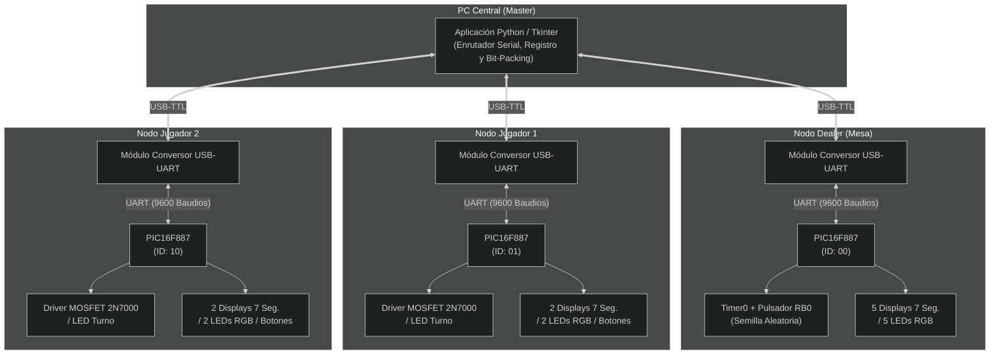
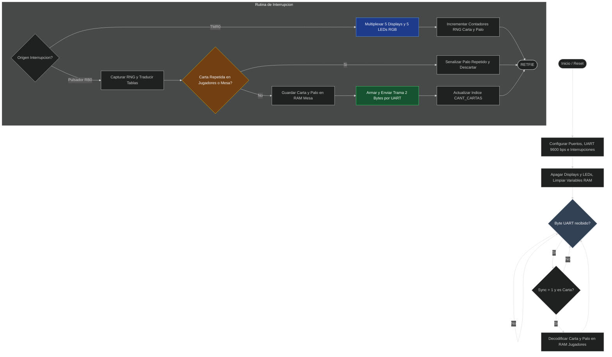
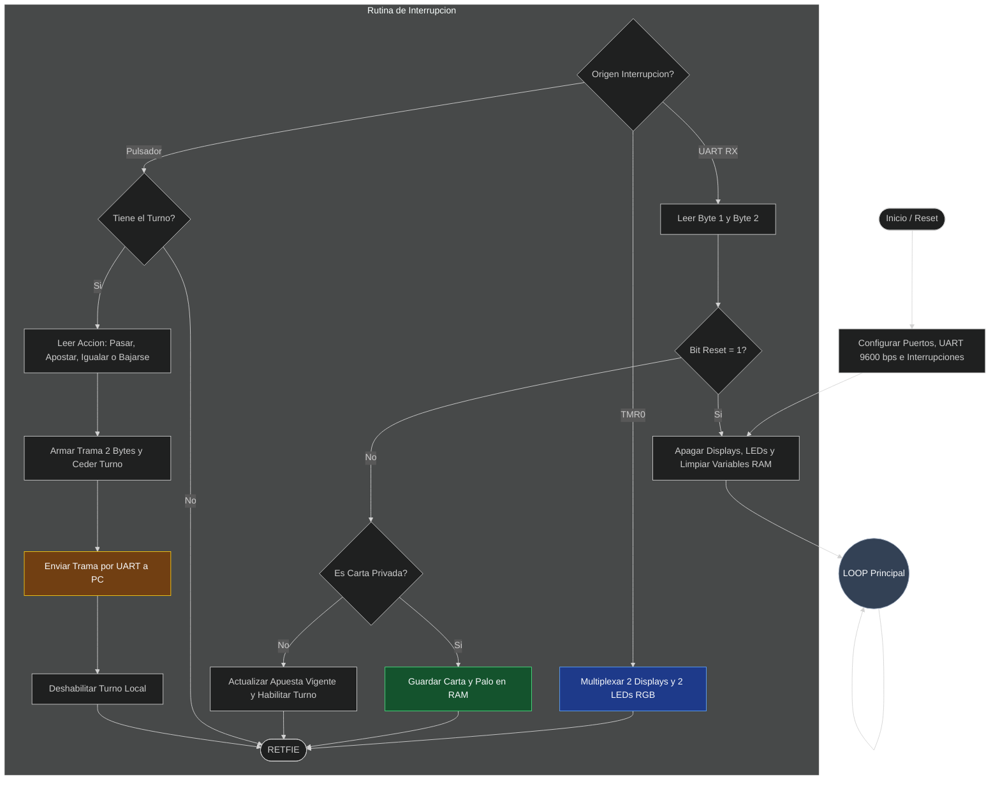

# Trabajo Final

**Electrónica Digital 2** — Facultad de Ciencias Exactas, Físicas y Naturales — Universidad Nacional de Córdoba

## 1. Requisitos

- Comunicación serie entre el microcontrolador y la PC.
- Interfaz de usuario.
- Protocolo de comunicación con el microcontrolador, documentado en este README.
- Un sensor, de los vistos en clase.
- Un actuador, de los vistos en clase.

## 2. Definition of Done (DoD) — Criterios de Aprobación de la Cátedra

Una historia de usuario se considera **"Done" (Finalizada y Aprobada)** cuando el Scrum Master (Ayudante) y el Product Owner (Docente) verifican los siguientes puntos:

1. **Uso de Ensamblador:** El código está escrito 100% en Ensamblador (.asm), compila sin errores ni *warnings* y genera el archivo `.hex`.
2. **Indicador de Turnos, Error, Ganador y Palo:** El sistema debe indicar al usuario mediante su interfaz su turno, quien fue el ganador, el palo de las cartas y si se genero algun error.
3. **Generacion Aleatoria:** Las cartas deben ser distribuidas y generadas de forma 100% ALEATORIA, garantizando la imparcialidad del dealer y llevando a un juego justo.
4. **Igualdad de Apuestas:** Los montos de las apuestas deben ser iguales, no se debe avanzar a la siguiente ronda con montos diferentes.
5. **Tiempo entre Turnos Aceptable:** El tiempo de juego y reparto debe ser aceptable, maneteniendo la comunicacion serie lo mas optimmizada posible, para jugar el turno nose debe esperar mas de 7 segundos.
6. **Presentacion del Hardware y funcionamiento correcto:** El prototipo montado no debe presentar obstrucciones visuales a los indicadores, debe presentar una disposicion ordenada y cables sin enriedos, no se aceptarra un hardware que deba utilizar "manias" para que funcione.

> El alcance y los detalles de cada trabajo se acuerdan con el docente de cada comisión.

## Trabajo Final Digital 2

### 1. Introducción y Objetivo del Proyecto

La mesa de poker es un sistema de seudo automatizacion de una partida tradicional de un juego de póker a travez de multi-nodo para el control de turnos, reparto de cartas y cartas mostradas en mesa de cada partida.
El objetivo del proyecto es poder interconectar los 3 nodos actuales del proyecto para poder tener una partida completa de poker con un registro virtual de todo lo que se hizo en al partida

### 2. Marco Conceptual y Principios de Funcionamiento

#### 2.1. Principio Básico

El sistema se divide en tres nodos físicos independientes basados en PIC16F887 (Dealer, Jugador 1 y Jugador 2) interconectados a una computadora central mediante conversores USB-UART (9600 bps, 8N1). La comunicación opera bajo un protocolo binario sincronizado de 2 bytes

* Byte 1 (Cabecera de Control): Contiene el bit de sincronismo (0x80), los 2 bits de turno/destino (turno_sig: 00 Dealer, 01 Jugador 1, 10 Jugador 2), los 2 bits de estado/acción (Pasar, Apostar, Bajarse, Igualar), el bit de condición (0 acción/apuesta, 1 carta) y el bit de reinicio global (0x82).

* Byte 2 (Carga Útil): Transporta el monto de la apuesta (0–127) cuando es una trama de acción, o la codificación del Palo (0–3) y el Valor de la carta (0–12: As, 2–10, J, Q, K) cuando es una carta.

Y donde toda la interfaz y gestion de la comunicacion serial queda implementada por un script de python integrado con tkinter y pyserial

Al iniciarse la partida por el boton comenzar de la interfaz, se mandar las cartas de partida a los jugadores y tambien al dealer para que pueda verificar que no se repitan las cartas. Al tener cada nodo su informacion, el dealer procede a "dar vuelta" las 3 primeras cartas de la mesa, y en cada finalizacion de partida da vuelta una nueva hasta la 5ta (Todo esto a travez del boton del dealer para tener la mayor aleatoriedad posible). Y cada ronda termina al momento de tener los valores de las apuesta de los jugadores igualadas

#### 2.2. Arquitectura de Control

El flujo de operación se resume en tres etapas:

* Inicio y Reparto Privado: Al comenzar la partida desde la interfaz en Python, se sortean y envían vía UART (9600 bps) dos cartas únicas a cada nodo jugador, quienes las almacenan en RAM y las muestran localmente en sus displays de 7 segmentos y LEDs RGB.

* Cartas Comunitarias (Nodo Dealer): Mediante interrupciones de TMR0 (multiplexado y contadores pseudoaleatorios) y un pulsador en RB0 con control anti-repetición, el Dealer genera y visualiza las 5 cartas de la mesa (3 en el Flop, 1 en el Turn y 1 en el River) en sus displays y LEDs RGB. Cada carta se envía a la PC para registrarse en pantalla, sin reenviarse a los jugadores ni de vuelta al Dealer.

* Apuestas, Turnos y Reinicio: Los jugadores envían sus decisiones (Pasar, Apostar, Bajarse o Igualar) mediante tramas de 2 bytes hacia Python. La PC actualiza el pozo, lee los bits de turno para redirigir la trama al siguiente jugador y, al cerrar la ronda, notifica al Dealer para poner la apuesta en cero y habilitar la siguiente carta. El botón de reinicio envía una trama global ([0x82, 0x00]) que limpia los tres nodos para una nueva mano.

### 3. Componentes de Hardware y Software

* Microcontroladores: 3 PIC16F887 (1 para el nodo Dealer y 2 para los nodos Jugadores).

* Visualización: 13 displays de 7 segmentos de ánodo común (5 en el Dealer para las cartas comunitarias y 4 en cada Jugador para sus cartas privadas y la apuesta).

* Señalización: 9 LEDs RGB de ánodo común (5 en el Dealer y 2 en cada Jugador) para identificar los palos, y 3 LEDs indicadores de turno (1 por nodo).

* Etapa de Potencia:13 transistores PNP para el multiplexado de dígitos (5 en el Dealer y 4 en cada Jugador).

* Reloj y Desacoplo: 3 cristales de cuarzo de 4 MHz y 6 capacitores cerámicos de 22 pF (2 por microcontrolador).

* Entradas y Resistencias: Pulsadores para reset (MCLR), sorteo y acciones de apuesta, junto con resistencias de 10 kΩ, 1 kΩ y 220 Ω (limitadoras de segmentos y LEDs).

* Actuador: Un led en el dealer que indique cuando esta activado (Manejando una oscilacion con un mosfet)

* Sensor: 1 potenciometro por cada jugador para el manejo de la apuesta 

* Comunicación: 3 módulos conversores USB-UART TTL para la conexión serial con la PC.

* Montaje: 3 protoboards, cables de interconexión y fuente de alimentación de 5 V.

* Software y Lenguajes: MPLAB X IDE (programación en Assembler), Proteus 8 (simulación circuital) y Python 3 con las librerías Tkinter y PySerial (interfaz gráfica y enrutador serial).

Diagrama de bloque general



<details>
<summary><h3>Dealer</h3></summary>

<blockquote>

<details>
<summary>diagrama de flujo del Dealer</summary>



</details>

<details>
<summary>esquemas e imagenes del Dealer</summary>

asdasdas

</details>

<details>
<summary>codigo del dealer</summary>

```asm
    LIST P=16F887
    #INCLUDE "p16f887.inc"
    ERRORLEVEL -305

;-----------------------------------
; Configuración
;-----------------------------------
    __CONFIG _CONFIG1, _FOSC_XT & _WDTE_OFF & _PWRTE_ON & _MCLRE_ON & _LVP_OFF
    __CONFIG _CONFIG2, _BOR4V_BOR40V & _WRT_OFF

;-----------------------------------
; Declaración de Variables
;-----------------------------------
CARTA_J1 EQU 0x20 ;Carta 1 jugador 1
CARTA_J2 EQU 0x21 ;Carta 2 jugador 1
CARTA_J3 EQU 0x22 ;Carta 1 jugador 2
CARTA_J4 EQU 0x23 ;Carta 2 jugador 2
PALO_J1 EQU 0x24 ;palo 1 jugador 1
PALO_J2 EQU 0x25 ;palo 2 jugador 1
PALO_J3 EQU 0x26 ;palo 1 jugador 2
PALO_J4 EQU 0x27 ;palo 2 jugador 2
DISPLAY_ACTUAL EQU 0x28 ; Índice multiplexación (0 a 4)
CANT_CARTAS EQU 0x29 ; 5 para comparar cartas sobre si
CARTA_0 EQU 0x2A ; DISPLAY 0
CARTA_1 EQU 0x2B ; DISPLAY 1
CARTA_2 EQU 0x2C ; DISPLAY 2
CARTA_3 EQU 0x2D ; DISPLAY 3
CARTA_4 EQU 0x2E ; DISPLAY 4
PALO_0 EQU 0x2F ;LED 0
PALO_1 EQU 0x30 ;LED 1
PALO_2 EQU 0x31 ;LED 2
PALO_3 EQU 0x32 ;LED 3
PALO_4 EQU 0x33 ;LED 4
CONT_VALOR_C EQU 0x34 ;contador 0-12
CONT_VALOR_P EQU 0x35 ;contador 0-3
VALOR_CARTA EQU 0x36 ;Carta guardado
VALOR_PALO EQU 0x37 ;Palo guardado
C_AUXILIAR EQU 0x38 ; Carta en decimal
P_AUXILIAR EQU 0x39 ; Palo en decimal
CONTADOR EQU 0x3A
FLAG_REPETICION EQU 0x3B; la carta se repitio
CARTA_J_CARGADA EQU 0x3C
UART_BYTE1 EQU 0x3D
UART_BYTE2 EQU 0x3E
UART_BYTE2_TEMP EQU 0x3F
INDICE_JUGADOR EQU 0x40

 
W_TEMP EQU 0x70
STAT_TEMP EQU 0x71


;-----------------------------------
    ORG 0x04
    GOTO ISR
    
    ORG 0x05
    GOTO INICIO

;-----------------------------------
INICIO:
    BCF STATUS, RP1 ;banco 1
    BSF STATUS, RP0
	
    CLRF TRISD ;todo el puerto como salida
	
    MOVLW b'10000000'
    MOVWF TRISC ;RC0-RC4 salidas del multiplexor RC7 entrada rx RC6 salida tx
	
    MOVLW b'00000001'
    MOVWF TRISB ;RB0 boton, RB1-3 salida colores led rgb, RB4 turno mosfet
	
    MOVLW b'00000010' 
    MOVWF OPTION_REG; Preescales 1:8 (Para aprox. 2 ms de interrupcion), Pull-up interno habilitado, Interrupción externa con flanco descendente.
	
    MOVLW .25
    MOVWF SPBRG         ; Baud rate = 9600
    BSF TXSTA, BRGH     ; Alta velocidad
    BCF TXSTA, SYNC     ; Modo asíncrono
	
    BCF STATUS, RP1 ;banco 0
    BCF STATUS, RP0

    MOVLW b'11111111'
    MOVWF PORTD
    CLRF PORTB

;Limpiar banderas
    BCF INTCON, T0IF
    BCF INTCON, INTF

;Hablitar interrupciones
    BSF INTCON, T0IE
    BSF INTCON, INTE
    BSF INTCON, GIE

;Precarga TMR0
    MOVLW .6
    MOVWF TMR0

; Habilitar puerto serie
    BSF RCSTA, SPEN     

; Habilitar recepción continua (Continuous Receive)
    BSF RCSTA, CREN     


    CLRF CONT_VALOR_C
    CLRF CONT_VALOR_P
    CLRF CANT_CARTAS
    CLRF INDICE_JUGADOR
    CLRF CARTA_J_CARGADA
    CLRF C_AUXILIAR
    CLRF P_AUXILIAR


LOOP:

; Rutina de Recepción y Procesamiento UART
    
    BTFSS PIR1, RCIF ; Espera a que el búfer de recepción tenga un byte listo (RCIF)
    GOTO LOOP
    
    MOVF RCREG, W ;Leer el Byte 1
    MOVWF UART_BYTE1
    
    BTFSS UART_BYTE1, 7 ;  Verificar si el Bit 7 es 1, revisa que este bien sincronizado
    GOTO LOOP
    
;Espera y lee el Byte 2 (Carga útil de datos)
ESPERAR_BYTE2:
    
    BTFSS PIR1, RCIF   ; Espera a que el búfer de recepción tenga un byte listo (RCIF)
    GOTO ESPERAR_BYTE2

    MOVF RCREG, W ;Leer el Byte 2
    MOVWF UART_BYTE2
    
    BTFSS UART_BYTE1, 2  ; 1 Indica que trae una carta)
    GOTO LOOP     ; Si es 0 es apuesta, se ignora para guardar cartas de jugadores aquí.


;El empaquetado en el uart_byte2 es 
;b7, que es el dato (1 carta, 0 apuesta)
;b 6-5, palo de las cartas (00, 01, 10, 11)
;b 4-1, valor de la carta (0-12 en binario)
;b0 sin funcion definida 

;Paso 1 guardar los valores
   
    MOVF UART_BYTE2, W
    MOVWF VALOR_CARTA
    MOVWF VALOR_PALO

;Paso 2 aislar el palo

    MOVLW b'01100000'
    ANDWF VALOR_PALO, F ;borro los demas valores dejo el equivalente a 01100000
    RRF VALOR_PALO, F ;00110000
    RRF VALOR_PALO, F ;00011000
    RRF VALOR_PALO, F ;00001100
    RRF VALOR_PALO, F ;00000110
    RRF VALOR_PALO, F ;00000011
    MOVLW b'00000011'
    ANDWF VALOR_PALO, F ;limpio cualquier carry que pueda haber quedado dejo el equivalente a 00000011

;Paso 3 aislar la carta

    MOVLW b'00011110'
    ANDWF VALOR_CARTA, F ;borro los demas valores dejo el equivalente a 00011110
    RRF VALOR_CARTA, F ;00001111
    MOVLW b'00001111'
    ANDWF VALOR_CARTA, F ;limpio cualquier carry que pueda haber quedado dejo el equivalente a 00001111

;Paso 4 guardo este valor en la carta y palo que toque
    
    MOVLW 0x20
    MOVWF FSR
    MOVF INDICE_JUGADOR, W
    ADDWF FSR, F           ; FSR apunta a la posición de carta del jugador (0x20, 0x21, 0x22 o 0x23)
    
; Guardar el valor de la carta formateado
    MOVF VALOR_CARTA, W
    MOVWF INDF          
    
    MOVLW .4
    ADDWF FSR, F           ; FSR apunta a la posición de palo del jugador (0x24, 0x25, 0x26 o             0x27)

    MOVF VALOR_PALO, W
    MOVWF INDF          

    INCF INDICE_JUGADOR, F
    MOVLW .3
    XORWF INDICE_JUGADOR, W
    BTFSC STATUS, Z
    CLRF INDICE_JUGADOR ; Si llega a 4, se reinicia a 0 para mantener un ciclo seguro

    GOTO LOOP	

;-----------------------------------
;Tablas
;-----------------------------------

TABLA_CARTAS:
     
    ADDWF PCL, F
    RETLW b'10001000' 
    ;A
    RETLW b'11000100' 
    ;2
    RETLW b'10110000' 
    ;3
    RETLW b'10011001' 
    ;4
    RETLW b'10000110' 
    ;5
    RETLW b'10000010' 
    ;6
    RETLW b'11111000' 
    ;7
    RETLW b'10000000' 
    ;8
    RETLW b'10100000' 
    ;9
    RETLW b'11111001' 
    ;1 (10)
    RETLW b'11100000' 
    ;J
    RETLW b'01000000' 
    ;Q
    RETLW b'10001001' 
    ;K
    
;-----------------------------------

    
TABLA_PALOS:

    ADDWF PCL, F
    RETLW b'11110111' 
    ;AZUL
    RETLW b'11111011' 
    ;VERDE
    RETLW b'11111101' 
    ;ROJO
    RETLW b'11111001' 
    ;AMARILLO

;-----------------------------------
;Subrutinas CALL
;-----------------------------------
    
MULTIPLEXADO:
    ; Apagar salidas momentáneamente para evitar efecto fantasma
    CLRF PORTD
    MOVLW b'00011111'
    MOVWF PORTC
    
    ; Seleccionar qué display/carta mostrar según DISPLAY_ACTUAL (0 a 4)
    MOVF DISPLAY_ACTUAL, W
    SUBLW 0
    BTFSC STATUS, Z
    GOTO M_DISP0
    
    MOVF DISPLAY_ACTUAL, W
    SUBLW 1
    BTFSC STATUS, Z
    GOTO M_DISP1

    MOVF DISPLAY_ACTUAL, W
    SUBLW 2
    BTFSC STATUS, Z
    GOTO M_DISP2

    MOVF DISPLAY_ACTUAL, W
    SUBLW 3
    BTFSC STATUS, Z
    GOTO M_DISP3

    MOVF DISPLAY_ACTUAL, W
    SUBLW 4
    BTFSC STATUS, Z
    GOTO M_DISP4

    GOTO FIN_MULTIPLEXADO

M_DISP0:
    MOVF CARTA_0, W
    MOVWF PORTD
    MOVF PALO_0, W
    MOVWF PORTB          ; O ajustar según los pines de color de PORTB
    BCF PORTC, 0         ; Activar el display 0 (RC0)
    GOTO ACTUALIZAR_INDICE

M_DISP1:
    MOVF CARTA_1, W
    MOVWF PORTD
    MOVF PALO_1, W
    MOVWF PORTB
    BCF PORTC, 1         ; Activar el display 1 (RC1)
    GOTO ACTUALIZAR_INDICE

M_DISP2:
    MOVF CARTA_2, W
    MOVWF PORTD
    MOVF PALO_2, W
    MOVWF PORTB
    BCF PORTC, 2         ; Activar el display 2 (RC2)
    GOTO ACTUALIZAR_INDICE

M_DISP3:
    MOVF CARTA_3, W
    MOVWF PORTD
    MOVF PALO_3, W
    MOVWF PORTB
    BCF PORTC, 3         ; Activar el display 3 (RC3)
    GOTO ACTUALIZAR_INDICE

M_DISP4:
    MOVF CARTA_4, W
    MOVWF PORTD
    MOVF PALO_4, W
    MOVWF PORTB
    BCF PORTC, 4         ; Activar el display 4 (RC4)
    GOTO ACTUALIZAR_INDICE

ACTUALIZAR_INDICE:
    INCF DISPLAY_ACTUAL, F
    MOVLW 0x05
    XORWF DISPLAY_ACTUAL, W
    BTFSC STATUS, Z
    CLRF DISPLAY_ACTUAL  ; Si llega a 5, reinicia a 0

FIN_MULTIPLEXADO:
    RETURN

;-----------------------------------


CARTAS_J_TABLA:
    
    MOVLW 0x20 
    MOVWF FSR
    MOVLW .4
    MOVWF CONTADOR
    INCF CARTA_J_CARGADA
    
ASOCIAR:
    
    MOVF INDF, W
    CALL TABLA_CARTAS
    MOVWF INDF
   
    MOVLW .4
    ADDWF FSR, F
    
    MOVF INDF, W
    CALL TABLA_PALOS
    MOVWF INDF
    
    MOVLW .3
    SUBWF FSR, F
    
    DECFSZ CONTADOR, F
    GOTO ASOCIAR
    RETURN

;-----------------------------------

COMPARAR_PALO_JUGADOR:
	
    MOVLW .4
    ADDWF FSR, F
    
    MOVF VALOR_PALO, W
    XORWF INDF, W
    
    BTFSC STATUS, Z
    INCF FLAG_REPETICION,F
    
    MOVLW .4
    SUBWF FSR, F
    
    RETURN

;-----------------------------------

COMPARAR_PALO_DEALER:
	
    MOVLW .5
    ADDWF FSR, F
    MOVF VALOR_PALO, W
    XORWF INDF, W
    
    BTFSC STATUS, Z
    INCF FLAG_REPETICION,F
    
    MOVLW .5
    SUBWF FSR, F
    
    RETURN

;-----------------------------------

PAQUETE_ENVIO:

TX_LIBRE1:    ; Esperar a que el transmisor UART esté libre
    
    BTFSS PIR1, TXIF
    GOTO TX_LIBRE1
    ;contador 0-2 para mandar en el turno que vuelva al dealer
    MOVLW b'10000100' ;b7 sincronizacion, b6-5 turno dealer, b4-3 el dealer no deja,b2 se manda una carta
    MOVWF TXREG

TX_LIBRE2:    ;Esperar a que el búfer de transmisión esté listo nuevamente

    BTFSS PIR1, TXIF
    GOTO TX_LIBRE2
    
;paso 1 habilitamos el bit que indica que el dato es una carta

    MOVLW b'10000000'
    MOVWF UART_BYTE2_TEMP   ; Variable temporal de 1 byte para armar el byte 2

;paso 2 agregamos el palo  CLRF 
    
    RLF P_AUXILIAR, F ;asumiendo valor ‘00000110’ lo busco llevar a los bit6-5
    RLF P_AUXILIAR, F ;‘00001100’
    RLF P_AUXILIAR, F ;‘00011000’
    RLF P_AUXILIAR, F ;‘00110000’
    RLF P_AUXILIAR, F ;‘01100000’
    MOVLW b'01100000'
    ANDWF P_AUXILIAR, W       ; limpiar cualquier carry
    ADDWF UART_BYTE2_TEMP, F

;paso 3 agregamos la carta     

    RLF C_AUXILIAR, F ;asumiendo valor ‘00011110’ lo busco llevar a los bit4-1 
    MOVLW b'00011110'
    ANDWF C_AUXILIAR, W       ; limpiar cualquier carry
    ADDWF UART_BYTE2_TEMP, F
    MOVF UART_BYTE2_TEMP, W
    MOVWF TXREG

    RETURN

;-----------------------------------
;Interrupcion
;-----------------------------------    

ISR:

Guardar_Contexto:
; ----- Guardado de contexto -----
    MOVWF W_TEMP
    SWAPF STATUS, W
    MOVWF STAT_TEMP


DISCRIMINAR:
; ---- Discriminación de interrupciones -----
    BTFSC INTCON, RBIF
    GOTO ISR_TECLA
    BTFSC INTCON, TMR0IF
    GOTO ISR_TMR0
    GOTO FIN_ISR

;-----------------------------------    
;Interrupcion Timer
;-----------------------------------    

    
ISR_TMR0:

    BCF STATUS, RP0
    BCF STATUS, RP1

    BCF INTCON, T0IF
	
    MOVLW .6
    MOVWF TMR0

    CALL MULTIPLEXADO

;Incremento de cartas
    INCF CONT_VALOR_C, F
    MOVLW 0x0D
    XORWF CONT_VALOR_C, W
    BTFSC STATUS, Z
    CLRF CONT_VALOR_C

;Incremento de palos
    INCF CONT_VALOR_P
    MOVLW 0X04
    XORWF CONT_VALOR_P, W
    BTFSC STATUS, Z
    CLRF CONT_VALOR_P

    GOTO FIN_ISR


;-----------------------------------
;Interrupcion Boton
;-----------------------------------

ISR_TECLA:
   
    BCF INTCON, INTF

;carga los valores del timer en variables
    
    MOVF CONT_VALOR_C, W
    MOVWF C_AUXILIAR
    MOVWF VALOR_CARTA
   
    MOVF CONT_VALOR_P, W
    MOVWF P_AUXILIAR
    MOVWF VALOR_PALO

    MOVF VALOR_CARTA, W
    CALL TABLA_CARTAS
    MOVWF VALOR_CARTA

    MOVF VALOR_PALO, W
    CALL TABLA_PALOS
    MOVWF VALOR_PALO

    
;carga los valores de las cartas de jugador en valor de tabla	
    MOVF CARTA_J_CARGADA, F
    BTFSC STATUS, Z
    CALL CARTAS_J_TABLA

COMPARAR_CARTA_JUGADOR:

    MOVLW 0x20
    MOVWF FSR
    MOVLW .4
    MOVWF CONTADOR
    CLRF FLAG_REPETICION

COMPARACION_J: ;Bucle

    MOVF VALOR_CARTA, W
    XORWF INDF, W ;compara las cartas
    
    BTFSC STATUS, Z
    CALL COMPARAR_PALO_JUGADOR
    
    BTFSC FLAG_REPETICION, 0
    GOTO CARTA_REPETIDA
    INCF FSR, F
    
    DECFSZ CONTADOR, F
    GOTO COMPARACION_J


COMPARAR_CARTA_DEALER:

    MOVLW 0x2A
    MOVWF FSR
    MOVF CANT_CARTAS, W
    MOVWF CONTADOR
    CLRF FLAG_REPETICION
    
COMPARACION_D: ;Bucle

    MOVF CANT_CARTAS, F
    BTFSC STATUS, Z
    GOTO CARGAR_CARTA
    
    MOVF VALOR_CARTA, W
    XORWF INDF, W
    
    BTFSC STATUS, Z
    CALL COMPARAR_PALO_DEALER
    
    BTFSC FLAG_REPETICION, 0
    GOTO CARTA_REPETIDA
    INCF FSR, F
    
    DECFSZ CONTADOR, F
    GOTO COMPARACION_D

    GOTO CARGAR_CARTA
    

CARTA_REPETIDA:
	
    MOVLW 0x2F ;Palo_0
    MOVWF FSR
    
    MOVF CANT_CARTAS, W
    ADDWF FSR, F
    
    MOVLW .3 
    CALL TABLA_PALOS
    
    MOVWF INDF
    
    GOTO FIN_ISR

	    
CARGAR_CARTA:
    	
    MOVLW 0x2A
    MOVWF FSR ;Se ubica en carta_0

    MOVF CANT_CARTAS, W
    ADDWF FSR, F ;suma la cantidad de lugares de la carta que hay que cargar

    MOVF VALOR_CARTA, W
    MOVWF INDF ;carta guardada
    
    MOVLW .5
    ADDWF FSR, F ;nos ubicamos en el palo de la carta
    
    MOVF VALOR_PALO, W
    MOVWF INDF ;palo guardado

    CALL PAQUETE_ENVIO
    
    INCF CANT_CARTAS, F
    MOVLW .4
    XORWF CANT_CARTAS, W
    BTFSC STATUS, Z
    CLRF CANT_CARTAS


    GOTO FIN_ISR
;hacer un xor para que cant cartas no pueda ser mas que 4
; tiene que enviar la carta al tx
;b7, que es el dato (1 carta, 0 apuesta)
;b 6-5, palo de las cartas (00, 01, 10, 11)
;b 4-1, valor de la carta (0-12 en binario)
;b0 sin funcion definida 


FIN_ISR:
    
    MOVWF STATUS
    SWAPF W_TEMP,F
    SWAPF W_TEMP,W

    RETFIE

    
    end


```

</details>

</blockquote>

</details>

<details>
<summary><h3>Jugadores</h3></summary>

<blockquote>

<details>
<summary>diagrama de flujo de los jugadores</summary>



</details>

<details>
<summary>esquemas e imagenes de los jugadores</summary>

asdasdas

</details>

<details>
<summary>codigo del jugador 1</summary>

```asm
LIST P=16F887
    #include <p16f887.inc>

; --- Bits de configuraci�n ---
    __CONFIG _CONFIG1, _FOSC_XT & _WDTE_OFF & _PWRTE_OFF & _MCLRE_ON & _CP_OFF & _CPD_OFF & _BOREN_ON & _IESO_ON & _FCMEN_ON & _LVP_OFF
    __CONFIG _CONFIG2, _BOR4V_BOR40V & _WRT_OFF

;-----------------------------------------------------------------------------------------------------------------------------------------------------------
;-----------------------------------------------------------------------------------------------------------------------------------------------------------                         ; 1 = J1, 2 = J2
    ID_JUGADOR  EQU  1 ; en jugador 2 cambiamos ID_JUGADOR EQU .2
    ID_TURNO    EQU  0xA0
    
CBLOCK	0x20
    APUESTA_INF	    ;CORRESPONDE AL DISP 4 RC3
    APUESTA_SUP    ;CORRESPONDEL AL DISP 3 RC2
    CARTA1	    ;CORRESPONDE AL DISP 1 RC0
    CARTA2	    ;CORRESPONDE AL DISP 2 RC1
    CONT_MULT
    APUESTA_J1
    APUESTA_J2
    TURNO
    TICK 
    CONT_REB	;incrementa solo si la comparaci�n es igual
    BTN_ACT	;lectura actual 
    BTN_ULT	;lectura anterior
    BYTE_DATO	
    BYTE_APUESTA 
    RX_ESTADO
    RX_BYTE1
    RX_BYTE2
    ADC_ALTO
    ADC_BAJO
    APUESTA_TEMP
    DECENA_APUESTA
    UNIDAD_APUESTA
    CONT_RECEPCION
    RX_LISTO
    INDICE_PALO 
    COLOR_C1
    COLOR_C2
    INDICE_CARTA
    BYTE_AUX
    POTENCIOMETRO
    APUESTA_ESTADO
ENDC
   
CBLOCK 0x70 
    W_TEMP 
    STATUS_TEMP
ENDC 

ORG 0X00
    GOTO INICIO 

ORG 0X04 
    GOTO ISR 

;-------------------------------------------------------------------------------
;				    TABLAS
;---------------------------------------------------------------------------
    
TABLA_CARTAS 
    ADDWF PCL, F
    RETLW b'10001000' ;A
    RETLW b'10100100' ;2
    RETLW b'10110000' ;3
    RETLW b'10011001' ;4
    RETLW b'10010010' ;5
    RETLW b'10000010' ;6
    RETLW b'11111000' ;7
    RETLW b'10000000' ;8
    RETLW b'10010000' ;9
    RETLW b'11111001' ;1 (10)
    RETLW b'11100001' ;J
    RETLW b'01000000' ;Q
    RETLW b'10001001' ;K
 
TABLA_PALOS
    ADDWF PCL, F
    RETLW b'11111110' ;ROJO
    RETLW b'11111101' ;VERDE
    RETLW b'11111011' ;AZUL
    RETLW b'11111100' ;AMARILLO

SELECCION_D7S 
    ADDWF PCL,F
    RETLW b'11111110' ; Display 0: 
    RETLW b'11111101' ; Display 1: 
    RETLW b'11111011' ; Display 2: 
    RETLW b'11110111' ; Display 3: 

TABLA_APUESTA 
    ADDWF PCL, F
    RETLW b'11000000' ;0
    RETLW b'11111001' ;1 
    RETLW b'10100100' ;2
    RETLW b'10110000' ;3
    RETLW b'10011001' ;4
    RETLW b'10010010' ;5
    RETLW b'10000010' ;6
    RETLW b'11111000' ;7
    RETLW b'10000000' ;8
    RETLW b'10010000' ;9  

    
    
INICIO
;===============================================================================
;   RB0-RB2 ENTRADAS BOTONES	RA2 = LED TURNO  RB4-RB6 = LED CARTAS 
;===============================================================================
; INICIALIZACI�N 
    ;deshabilitar entradas anal�gicas 
    
    BANKSEL ANSEL
    MOVLW b'00000001'
    MOVWF ANSEL 
    
    BANKSEL ANSELH
    CLRF ANSELH
;-------------------------------------------------------------------------------
;	alta velocidad a 9600	sin bit de paridad  asincronica	 
;-------------------------------------------------------------------------------
    BANKSEL ADCON0
    MOVLW b'01000001'	    ;AN0 COMO ENTRADA 
    MOVWF ADCON0	     
    
    BANKSEL ADCON1	    
    MOVLW b'10000000'	    ;justificado a la derecha, voltaje de referencai
    MOVWF ADCON1	    ; Vss y Vdd
    
    
    
    BANKSEL PIE1	    
    MOVLW b'00100000'
    MOVWF PIE1 
    
    MOVLW b'00100110'	
    MOVWF TXSTA		 
    
    BANKSEL RCSTA	    ;habilita modulo UART
    MOVLW b'10010000'
    MOVWF RCSTA 
    
    BANKSEL BAUDCTL
    MOVLW b'00001000'		
    MOVWF BAUDCTL
    
    BANKSEL SPBRG	    ; transmisios a 9600 baudios 
    MOVLW .103
    MOVWF SPBRG
    
    BANKSEL SPBRGH 
    CLRF SPBRGH  
     
;configuracion puertos
    BANKSEL TRISD
    CLRF    TRISD           ; PORTD todo salida (segmentos)
     BANKSEL TRISC
    MOVLW b'10000000'	    ;RC0-RC3 salidas (selecci�n), 
    MOVWF TRISC		    ;RC7 entrada RX
			    ;RC6 salida TX
			    
    MOVLW b'00000001'	    ; RA0 ENTRADA ANAL�GICA 
    MOVWF TRISA		    ;RA2 LED TURNO
    
    MOVLW 0x00
    MOVWF TRISE		    ;RE0-RE2 como salida para los leds 
    
    MOVLW B'00000111'	    ;PRB0-RB2 COMO ENTRADAS, EL RESTO COMO SALIDA
    MOVWF TRISB
    
    BCF OPTION_REG,7	    ;HABILITACI�N PULL_UPS 
    BANKSEL WPUB
    MOVLW b'00000111'
    MOVWF WPUB		    ;RB0-RB5 PULL UPS (SIEMPRE TIENE UN 1)

;inicializaci�n variables
;--------------------------------------------------------------
    BANKSEL PORTC
    MOVLW 0xFF 
    MOVWF PORTC		    ;Displays pagados 
    MOVWF PORTD		    ;Segmentos deshabilitados
    MOVWF PORTE
    MOVWF COLOR_C1
    MOVWF COLOR_C2
    MOVWF CARTA1
    MOVWF CARTA2
    BCF PORTA,2
    CLRF CONT_MULT
    MOVLW b'01110000'
    MOVWF PORTB 
    CLRF APUESTA_J1
    CLRF APUESTA_J2
    CLRF APUESTA_SUP
    CLRF APUESTA_INF
    CLRF TURNO
    CLRF TICK 
    CLRF CONT_REB
    CLRF BYTE_APUESTA 
    CLRF BYTE_DATO 
    MOVLW b'00000111'
    MOVWF BTN_ULT	;Iinician todos los botones en 1, tienen las pul-ups 
    CLRF RX_ESTADO 
    CLRF RX_BYTE1
    CLRF RX_BYTE2
    CLRF ADC_ALTO
    CLRF ADC_BAJO 
    CLRF APUESTA_TEMP
    CLRF DECENA_APUESTA
    CLRF UNIDAD_APUESTA
    CLRF CONT_RECEPCION 
    CLRF RX_LISTO
    CLRF INDICE_PALO
    CLRF INDICE_CARTA
    CLRF BYTE_AUX 
    CLRF POTENCIOMETRO 
    CLRF APUESTA_ESTADO
;===============================================================================   
;	    TIMER0		PRESCALER 1:16 TMER0 = 100
;	    FOSC = 4MHz --> CICLO DE INTERRUPCI�N = 1us
;	    156 INCREMENTOS * 16 = 2.5 ms 
;===============================================================================
    
  BANKSEL OPTION_REG 
  MOVLW b'00000011'
  MOVWF OPTION_REG	    ;PRESCALER 1:16	    PRESCALER ASIGNADO A TIMER0
 
  BANKSEL TMR0 
  MOVLW .100
  MOVWF TMR0
  
; Limpiamos las banderas 
  BANKSEL PORTB
  BCF INTCON, T0IF
  

; Habilitaci�n interrupciones TMR0 
  BSF INTCON, T0IE 
  BSF INTCON,PEIE
  BSF INTCON,GIE 
  
;===============================================================================
;				lazo principal
;===============================================================================
  
; transmi en serie  
LOOP 
  BTFSC RX_LISTO,0	;Llego una trama completa ? 
  GOTO SERVICIO_RX
  
  BTFSS TURNO,0 
  GOTO LOOP
  
  BTFSS APUESTA_ESTADO,0
  GOTO REVISAR_BOTONES
  CALL INICIA_CONVERSION

REVISAR_BOTONES 
 
  BTFSS TICK,0		;Solo muestreo cada 2.5 ms 
  GOTO LOOP
  BCF TICK,0
  MOVF PORTB,W
  ANDLW b'00000111'	;RB0-RB2 (activos en bajo) si se pone en cero,se apreto
  MOVWF BTN_ACT		    ;valor actual para comparar desp
  XORLW b'00000111'
  BTFSC STATUS,Z	   ;Z=1, ninguno apretado 
  GOTO REB_SUELTO
  MOVF BTN_ACT,W
  XORWF BTN_ULT,W
  BTFSS STATUS,Z	    ;Z=0 cambio el bton respecto al anterior 
  GOTO REB_CAMBIO
  
  INCF CONT_REB,F	    ;la lectura es la misma, suma 1
  MOVLW .8
  XORWF CONT_REB,W 
  BTFSS STATUS,Z	    ;Z = 0 no pasaron 20ms 
  GOTO LOOP
; se confirm� la pulsaci�n, pasa a verificar los botones
 	    
  BTFSS PORTB,0		    ;boton apretado vale 0 
  GOTO  APUESTA 
  BTFSS PORTB,1
  GOTO IGUALAR 
  BTFSS PORTB,2 
  GOTO RETIRA 
  GOTO LOOP
 
REB_SUELTO 
  
  CLRF CONT_REB		    ;fue rebote, se reinicia
  MOVLW b'00000111'
  MOVWF BTN_ULT		    ;Vuelven a estar todos sin apretar
  GOTO LOOP 

REB_CAMBIO 
  MOVF BTN_ACT,W 
  MOVWF BTN_ULT	    ;guarda la �ltima lectura como referencia para la proxima
  CLRF CONT_REB	    ;vuelve a inicar el contador
  GOTO LOOP
  
;                            Servicio RX
 ;============================================================================== 
 SERVICIO_RX 
  BTFSC RX_BYTE1,2	;Es una carta ? Co = 1
  GOTO PROCESAR_RX
  GOTO PROCESAR_APUESTA  

PROCESAR_RX	;Procesa datos carta 
  
    MOVF CONT_RECEPCION, W
    XORLW .2
    BTFSC STATUS,Z		;si contador es 2 => z = 1  
    GOTO FIN_PROCESAMIENTO	;Puede prcesar las cartas

    CALL PROCESAR_PALO
    CALL PROCESAR_NUMERO

    INCF CONT_RECEPCION, F
    
    GOTO FIN_PROCESAMIENTO  
;Subrutina para decodificar la apuesta -------------------------------------   
PROCESAR_APUESTA 
    MOVF RX_BYTE2,W	    ;Limpiamos el byte2 
    ANDLW b'01111111'
    MOVWF APUESTA_J2
    BTFSC STATUS,Z 
    CALL REINICIA_APUESTA
    
    MOVF RX_BYTE1,W 
    ANDLW b'01100000'
    XORLW (ID_JUGADOR << 5 )	; J1 = 0x20, J2 = 0x40
    BTFSS STATUS,Z
    GOTO FIN_PROCESAMIENTO 
    BSF TURNO,0	    ;habilita el poling de los botones
    BSF PORTA,2    ; Enciende LED de turno
    GOTO FIN_PROCESAMIENTO 

 REINICIA_APUESTA 
    MOVF APUESTA_J2,W
    MOVWF APUESTA_J1
    MOVWF POTENCIOMETRO 
    CALL LOOP_APUESTA
    RETURN
;--Subrutina para decodificar el palo -----------------
PROCESAR_PALO
    MOVF RX_BYTE2,W
    ANDLW b'01100000'	    ;Conservar bits 6 y 5

    MOVWF BYTE_AUX
    BCF STATUS,C  ;Se desplazan los bits 6 y 5, cinco posiciones a la derecha
    RRF BYTE_AUX,F   

    BCF STATUS,C
    RRF BYTE_AUX,F

    BCF STATUS,C
    RRF BYTE_AUX,F

    BCF STATUS,C
    RRF BYTE_AUX,F

    BCF STATUS,C
    RRF BYTE_AUX,F

    MOVF BYTE_AUX,W  
    MOVWF INDICE_PALO
    
    MOVF INDICE_PALO, W
    CALL TABLA_PALOS

    MOVWF BYTE_AUX
    
    MOVF CONT_RECEPCION,W	;incrementa una vez que termina de procesar todo
    XORLW .1
    BTFSC STATUS, Z		
    GOTO GUARDAR_COLOR2
    
GUARDAR_COLOR1 		
    MOVF BYTE_AUX,W
    MOVWF COLOR_C1
    RETURN

GUARDAR_COLOR2
    MOVF BYTE_AUX,W
    MOVWF COLOR_C2
    RETURN
    
;--Subrutina para decodificar el numero de la carta-----------------------------
PROCESAR_NUMERO 
    MOVF RX_BYTE2,W
    ANDLW b'00011110'		;limpia el byte para guardarlo en byte_aux 
    
    MOVWF BYTE_AUX

    BCF STATUS,C   ;Se desplaza una posicion a la derecha
    RRF BYTE_AUX,F

    MOVF BYTE_AUX,W
    MOVWF INDICE_CARTA
    
    MOVF INDICE_CARTA, W
    CALL TABLA_CARTAS

    MOVWF BYTE_AUX 
    MOVF CONT_RECEPCION, W
    XORLW .1
    BTFSC STATUS, Z
    GOTO GUARDAR_CARTA2

GUARDAR_CARTA1
    MOVF BYTE_AUX,W
    MOVWF CARTA1
    RETURN

GUARDAR_CARTA2
    MOVF BYTE_AUX,W
    MOVWF CARTA2
    RETURN
    
FIN_PROCESAMIENTO   
  BCF RX_LISTO,0
  GOTO LOOP
  
;				ISR
;===============================================================================
ISR 
  ; Guardado contexto 
  MOVWF W_TEMP
  SWAPF STATUS,W 
  MOVWF STATUS_TEMP
  
  BANKSEL RCSTA
  BTFSC RCSTA,OERR
  CALL RECUPERAR_OERR
  
  BANKSEL PIR1
  BTFSC PIR1,RCIF
  CALL RUTINA_UART
  
REVISAR_TMR0
  BTFSS INTCON,T0IF	;Verifica si la interrupcion fue por TMR0  
  GOTO FIN_ISR

;------------ RUTINA TMER0-----------------
RUTINA_TMR0 
  
  BCF INTCON, T0IF 
  MOVLW .100
  MOVWF TMR0
  BSF TICK,0
  
;Apagamos para evitar sombras
  MOVLW 0xFF	     
  MOVWF PORTC
  MOVLW b'00000111'
  MOVWF PORTE

;Envio valors al display segun cont_mult 
  MOVF CONT_MULT,W
  BTFSC STATUS,Z 
  GOTO DISP4	    ;CONT_MUX = 0 => RC0(APUESTA_INF)
  XORLW .1
  BTFSC STATUS,Z 
  GOTO DISP3	    ;CONT_MUX = 1 => RC1 (APUESTA_SUP)
  MOVF CONT_MULT,W
  XORLW .2	    
  BTFSC STATUS,Z    ;CON_MUX = 2 => RC2 (CARTA 2 + RGD CARTA2 )
  GOTO DISP2
DISP1		    ;CON_MUX = 3 => RC3 (CARTA 1 + RGB CARTA1)
    MOVF COLOR_C1,W
    MOVWF PORTE
    MOVF CARTA1,W
    GOTO CARGAR  
DISP2
    MOVF COLOR_C2,W
    MOVWF PORTE
    MOVF CARTA2,W
    GOTO CARGAR
DISP4 
    MOVF APUESTA_INF,W
    GOTO CARGAR   
DISP3 
    MOVF APUESTA_SUP,W 

CARGAR 
    MOVWF PORTD		    ;Carga a portD el valro que toca
    MOVF CONT_MULT,W
    CALL SELECCION_D7S	    ;Enciende el display correspondiente 
    MOVWF PORTC 
  
    INCF CONT_MULT,F
    MOVF CONT_MULT,W
    XORLW .4 
    BTFSC STATUS,Z 
    CLRF CONT_MULT	    ;Reinicia la cuenta del multiplexado.
    GOTO FIN_ISR 
 

;-------- RUTINA UART--------------------------------    
RUTINA_UART 
    BTFSC RX_ESTADO,0
    GOTO SEGUNDO_BYTE
    
PRIMER_BYTE 
  BANKSEL RCREG
  MOVF RCREG,W	    ;Leer primer byte
  MOVWF RX_BYTE1
  BSF RX_ESTADO,0
  RETURN
  
SEGUNDO_BYTE 
  BANKSEL RCREG
  MOVF RCREG, w ; Leer segundo byte
  MOVWF RX_BYTE2
  BSF RX_LISTO, 0
  BCF RX_ESTADO, 0
  RETURN 
 
FIN_ISR 
  ;RECUPERAMOS CONTEXTO 
  SWAPF STATUS_TEMP,W 
  MOVWF STATUS 
  SWAPF W_TEMP,F 
  SWAPF W_TEMP,W 
  RETFIE 

RECUPERAR_OERR
    BANKSEL RCSTA

    BCF RCSTA,CREN       ; Deshabilita recepci�n continua
    BSF RCSTA,CREN       ; Vuelve a habilitar recepci�n

    CLRF RX_ESTADO       ; Descarta una trama incompleta

    RETURN
;===============================================================================
;			    RUTINAS BOTONES 
;===============================================================================
APUESTA 

    BTFSC APUESTA_ESTADO,0 ; Es la primera pulsaci�n del boton apuesta?
    GOTO CONFIRMAR_APUESTA ; Segunda pulsaci�n

    BSF APUESTA_ESTADO,0 ; Primera pulsaci�n

    GOTO LOOP


CONFIRMAR_APUESTA
  
;Verificamos que el valor de la apuesta sea mayor a la apuesta del otro jugador
  MOVF APUESTA_J2,W
  SUBWF POTENCIOMETRO,W 
  BTFSC STATUS,Z	    ;iugal: no vale
  GOTO LOOP
  BTFSS STATUS,C	    ;menor:no vale
  GOTO LOOP 
  MOVF POTENCIOMETRO,W
  MOVWF APUESTA_J1
  MOVLW 0x08		    ;guardamos el estado de la acci�n  
  MOVWF BYTE_DATO 
  GOTO FIN_TURNO

INICIA_CONVERSION 
    BANKSEL ADCON0
    BSF ADCON0, 1 	;Inicia la conversi�n 
    
ESPERAR_ADC
    BTFSC ADCON0,1	;Sigue conviertiendo?
    GOTO ESPERAR_ADC  
    
    BANKSEL ADRESL 
    MOVF ADRESL,W
    BANKSEL ADC_BAJO	;Guarda los 8 bits bajos de la conversi�n 
    MOVWF ADC_BAJO
    
    BANKSEL ADRESH
    MOVF ADRESH, w
    ANDLW b'00000011'
    BANKSEL ADC_BAJO	;Guarda los 2 bits altos de la conversi�n
    MOVWF ADC_ALTO    
    
    CLRF POTENCIOMETRO 		

ESCALAR_ADC
    MOVF ADC_ALTO,F
    BTFSS STATUS,Z	    ;ADC_ALTO = 0 ?
    GOTO RESTAR_10 
    
    MOVLW .10		    ;adc_alto = 0, revisar adc_bajo
    SUBWF ADC_BAJO,W
    BTFSS STATUS, C	    ;adc_bajo < 10 ? Si C = 0
    GOTO FIN_ESCALADO

    MOVLW .10		    ;adc_bajo >= 10, se resta le 10
    SUBWF ADC_BAJO,F
    GOTO INCREMENTAR_APUESTA

RESTAR_10 
    MOVLW .10
    SUBWF ADC_BAJO,F

    BTFSS STATUS,C	;Ve si hay carry, "pide prestado"
    DECF ADC_ALTO,F

INCREMENTAR_APUESTA

    INCF POTENCIOMETRO,F	;Incrementamos en 1 las veces que se resta 10
    GOTO ESCALAR_ADC

FIN_ESCALADO		;Limitar la apuesta a 99

    MOVLW .100
    SUBWF POTENCIOMETRO,W

    BTFSS STATUS, C	;Si apuesta >= 100 se muestra 99 
    GOTO LOOP_APUESTA 

    MOVLW .99
    MOVWF POTENCIOMETRO
    
LOOP_APUESTA  
    MOVF POTENCIOMETRO,W
    MOVWF APUESTA_TEMP

    CLRF DECENA_APUESTA

LOOP_DECENAS
    MOVLW .10 
    SUBWF APUESTA_TEMP,W

    BTFSS STATUS, C		;apuesta_temp < 10? Si C=0
    GOTO FIN_DECENAS

    MOVLW .10 
    SUBWF APUESTA_TEMP,F 	;apuesta_temp - 10

    INCF DECENA_APUESTA,F
    GOTO LOOP_DECENAS

FIN_DECENAS

    MOVF APUESTA_TEMP ,w 
    MOVWF UNIDAD_APUESTA

MOSTRAR_APUESTA
    MOVF DECENA_APUESTA,W
    CALL TABLA_APUESTA
    movwf APUESTA_SUP
    
    MOVF UNIDAD_APUESTA,W
    CALL TABLA_APUESTA
    MOVWF APUESTA_INF
    RETURN
;---------------------------------------------------------------------------
RETIRA  
  MOVLW 0xFF		    ;Apagamos displys cartas
  MOVWF CARTA1
  MOVWF CARTA2
  MOVWF COLOR_C1
  MOVWF COLOR_C2
  MOVWF PORTE	    ;
  MOVLW 0x10		    ;Guardamos el estado de la acci�n 		    
  MOVWF BYTE_DATO
  CLRF APUESTA_J1
  CLRF CONT_RECEPCION
  GOTO FIN_TURNO
;---------------------------------------------------------------------------
IGUALAR 
  MOVF APUESTA_J2 ,W
  MOVWF APUESTA_J1
  MOVWF POTENCIOMETRO 
  CALL LOOP_APUESTA
  MOVLW 0x18		    ;Guardamos el estado de la acci�n  
  MOVWF BYTE_DATO 
  GOTO FIN_TURNO 


FIN_TURNO
  BCF TURNO,0
  BCF APUESTA_ESTADO,0
  CLRF CONT_REB
  
;Terminamos de acomodar byte 1 
  MOVLW ID_TURNO	    ;1 01 00000
  IORWF BYTE_DATO,F
  
;acomodamos byte 2 
  MOVF APUESTA_J1,W
  IORWF BYTE_APUESTA,F 
  
;Envio  
  BANKSEL PIR1
ESPERA1		    ;Verificamos si la UART est� lista para enviar el segundo byte
  BTFSS PIR1,TXIF	
  GOTO ESPERA1
  MOVF BYTE_DATO,W
  MOVWF TXREG
ESPERA2   
  BTFSS PIR1,TXIF 	
  GOTO ESPERA2
  MOVF BYTE_APUESTA,W 
  MOVWF TXREG 

  BCF PORTA,2    ; Apaga LED de turno 
  CLRF BYTE_APUESTA	;Limpiamos el byte de la apuesta
  GOTO LOOP
 
END
```

</details>

<details>
<summary>codigo del jugador 2</summary>

```asm
LIST P=16F887
    #include <p16f887.inc>

; --- Bits de configuraci�n ---
    __CONFIG _CONFIG1, _FOSC_XT & _WDTE_OFF & _PWRTE_OFF & _MCLRE_ON & _CP_OFF & _CPD_OFF & _BOREN_ON & _IESO_ON & _FCMEN_ON & _LVP_OFF
    __CONFIG _CONFIG2, _BOR4V_BOR40V & _WRT_OFF

;-----------------------------------------------------------------------------------------------------------------------------------------------------------
;-----------------------------------------------------------------------------------------------------------------------------------------------------------                         ; 1 = J1, 2 = J2
    ID_JUGADOR  EQU  2 ; en jugador 2 cambiamos ID_JUGADOR EQU .2
    ID_TURNO    EQU  0xC0
    
CBLOCK	0x20
    APUESTA_INF	    ;CORRESPONDE AL DISP 4 RC3
    APUESTA_SUP    ;CORRESPONDEL AL DISP 3 RC2
    CARTA1	    ;CORRESPONDE AL DISP 1 RC0
    CARTA2	    ;CORRESPONDE AL DISP 2 RC1
    CONT_MULT
    APUESTA_J1
    APUESTA_J2
    TURNO
    TICK 
    CONT_REB	;incrementa solo si la comparaci�n es igual
    BTN_ACT	;lectura actual 
    BTN_ULT	;lectura anterior
    BYTE_DATO	
    BYTE_APUESTA 
    RX_ESTADO
    RX_BYTE1
    RX_BYTE2
    ADC_ALTO
    ADC_BAJO
    APUESTA_TEMP
    DECENA_APUESTA
    UNIDAD_APUESTA
    CONT_RECEPCION
    RX_LISTO
    INDICE_PALO 
    COLOR_C1
    COLOR_C2
    INDICE_CARTA
    BYTE_AUX
    POTENCIOMETRO
    APUESTA_ESTADO
ENDC
   
CBLOCK 0x70 
    W_TEMP 
    STATUS_TEMP
ENDC 

ORG 0X00
    GOTO INICIO 

ORG 0X04 
    GOTO ISR 

;-------------------------------------------------------------------------------
;				    TABLAS
;---------------------------------------------------------------------------
    
TABLA_CARTAS 
    ADDWF PCL, F
    RETLW b'10001000' ;A
    RETLW b'10100100' ;2
    RETLW b'10110000' ;3
    RETLW b'10011001' ;4
    RETLW b'10010010' ;5
    RETLW b'10000010' ;6
    RETLW b'11111000' ;7
    RETLW b'10000000' ;8
    RETLW b'10010000' ;9
    RETLW b'11111001' ;1 (10)
    RETLW b'11100001' ;J
    RETLW b'01000000' ;Q
    RETLW b'10001001' ;K
 
TABLA_PALOS
    ADDWF PCL, F
    RETLW b'11111110' ;ROJO
    RETLW b'11111101' ;VERDE
    RETLW b'11111011' ;AZUL
    RETLW b'11111100' ;AMARILLO

SELECCION_D7S 
    ADDWF PCL,F
    RETLW b'11111110' ; Display 0: 
    RETLW b'11111101' ; Display 1: 
    RETLW b'11111011' ; Display 2: 
    RETLW b'11110111' ; Display 3: 

TABLA_APUESTA 
    ADDWF PCL, F
    RETLW b'11000000' ;0
    RETLW b'11111001' ;1 
    RETLW b'10100100' ;2
    RETLW b'10110000' ;3
    RETLW b'10011001' ;4
    RETLW b'10010010' ;5
    RETLW b'10000010' ;6
    RETLW b'11111000' ;7
    RETLW b'10000000' ;8
    RETLW b'10010000' ;9  

    
    
INICIO
;===============================================================================
;   RB0-RB2 ENTRADAS BOTONES	RA2 = LED TURNO  RB4-RB6 = LED CARTAS 
;===============================================================================
; INICIALIZACI�N 
    ;deshabilitar entradas anal�gicas 
    
    BANKSEL ANSEL
    MOVLW b'00000001'
    MOVWF ANSEL 
    
    BANKSEL ANSELH
    CLRF ANSELH
;-------------------------------------------------------------------------------
;	alta velocidad a 9600	sin bit de paridad  asincronica	 
;-------------------------------------------------------------------------------
    BANKSEL ADCON0
    MOVLW b'01000001'	    ;AN0 COMO ENTRADA 
    MOVWF ADCON0	     
    
    BANKSEL ADCON1	    
    MOVLW b'10000000'	    ;justificado a la derecha, voltaje de referencai
    MOVWF ADCON1	    ; Vss y Vdd
    
    
    
    BANKSEL PIE1	    
    MOVLW b'00100000'
    MOVWF PIE1 
    
    MOVLW b'00100110'	
    MOVWF TXSTA		 
    
    BANKSEL RCSTA	    ;habilita modulo UART
    MOVLW b'10010000'
    MOVWF RCSTA 
    
    BANKSEL BAUDCTL
    MOVLW b'00001000'		
    MOVWF BAUDCTL
    
    BANKSEL SPBRG	    ; transmisios a 9600 baudios 
    MOVLW .103
    MOVWF SPBRG
    
    BANKSEL SPBRGH 
    CLRF SPBRGH  
     
;configuracion puertos
    BANKSEL TRISD
    CLRF    TRISD           ; PORTD todo salida (segmentos)
     BANKSEL TRISC
    MOVLW b'10000000'	    ;RC0-RC3 salidas (selecci�n), 
    MOVWF TRISC		    ;RC7 entrada RX
			    ;RC6 salida TX
			    
    MOVLW b'00000001'	    ; RA0 ENTRADA ANAL�GICA 
    MOVWF TRISA		    ;RA2 LED TURNO
    
    MOVLW 0x00
    MOVWF TRISE		    ;RE0-RE2 como salida para los leds 
    
    MOVLW B'00000111'	    ;PRB0-RB2 COMO ENTRADAS, EL RESTO COMO SALIDA
    MOVWF TRISB
    
    BCF OPTION_REG,7	    ;HABILITACI�N PULL_UPS 
    BANKSEL WPUB
    MOVLW b'00000111'
    MOVWF WPUB		    ;RB0-RB5 PULL UPS (SIEMPRE TIENE UN 1)

;inicializaci�n variables
;--------------------------------------------------------------
    BANKSEL PORTC
    MOVLW 0xFF 
    MOVWF PORTC		    ;Displays pagados 
    MOVWF PORTD		    ;Segmentos deshabilitados
    MOVWF PORTE
    MOVWF COLOR_C1
    MOVWF COLOR_C2
    MOVWF CARTA1
    MOVWF CARTA2
    BCF PORTA,2
    CLRF CONT_MULT
    MOVLW b'01110000'
    MOVWF PORTB 
    CLRF APUESTA_J1
    CLRF APUESTA_J2
    CLRF APUESTA_SUP
    CLRF APUESTA_INF
    CLRF TURNO
    CLRF TICK 
    CLRF CONT_REB
    CLRF BYTE_APUESTA 
    CLRF BYTE_DATO 
    MOVLW b'00000111'
    MOVWF BTN_ULT	;Iinician todos los botones en 1, tienen las pul-ups 
    CLRF RX_ESTADO 
    CLRF RX_BYTE1
    CLRF RX_BYTE2
    CLRF ADC_ALTO
    CLRF ADC_BAJO 
    CLRF APUESTA_TEMP
    CLRF DECENA_APUESTA
    CLRF UNIDAD_APUESTA
    CLRF CONT_RECEPCION 
    CLRF RX_LISTO
    CLRF INDICE_PALO
    CLRF INDICE_CARTA
    CLRF BYTE_AUX 
    CLRF POTENCIOMETRO 
    CLRF APUESTA_ESTADO
;===============================================================================   
;	    TIMER0		PRESCALER 1:16 TMER0 = 100
;	    FOSC = 4MHz --> CICLO DE INTERRUPCI�N = 1us
;	    156 INCREMENTOS * 16 = 2.5 ms 
;===============================================================================
    
  BANKSEL OPTION_REG 
  MOVLW b'00000011'
  MOVWF OPTION_REG	    ;PRESCALER 1:16	    PRESCALER ASIGNADO A TIMER0
 
  BANKSEL TMR0 
  MOVLW .100
  MOVWF TMR0
  
; Limpiamos las banderas 
  BANKSEL PORTB
  BCF INTCON, T0IF
  

; Habilitaci�n interrupciones TMR0 
  BSF INTCON, T0IE 
  BSF INTCON,PEIE
  BSF INTCON,GIE 
  
;===============================================================================
;				lazo principal
;===============================================================================
  
; transmi en serie  
LOOP 
  BTFSC RX_LISTO,0	;Llego una trama completa ? 
  GOTO SERVICIO_RX
  
  BTFSS TURNO,0 
  GOTO LOOP
  
  BTFSS APUESTA_ESTADO,0
  GOTO REVISAR_BOTONES
  CALL INICIA_CONVERSION

REVISAR_BOTONES 
 
  BTFSS TICK,0		;Solo muestreo cada 2.5 ms 
  GOTO LOOP
  BCF TICK,0
  MOVF PORTB,W
  ANDLW b'00000111'	;RB0-RB2 (activos en bajo) si se pone en cero,se apreto
  MOVWF BTN_ACT		    ;valor actual para comparar desp
  XORLW b'00000111'
  BTFSC STATUS,Z	   ;Z=1, ninguno apretado 
  GOTO REB_SUELTO
  MOVF BTN_ACT,W
  XORWF BTN_ULT,W
  BTFSS STATUS,Z	    ;Z=0 cambio el bton respecto al anterior 
  GOTO REB_CAMBIO
  
  INCF CONT_REB,F	    ;la lectura es la misma, suma 1
  MOVLW .8
  XORWF CONT_REB,W 
  BTFSS STATUS,Z	    ;Z = 0 no pasaron 20ms 
  GOTO LOOP
; se confirm� la pulsaci�n, pasa a verificar los botones
 	    
  BTFSS PORTB,0		    ;boton apretado vale 0 
  GOTO  APUESTA 
  BTFSS PORTB,1
  GOTO IGUALAR 
  BTFSS PORTB,2 
  GOTO RETIRA 
  GOTO LOOP
 
REB_SUELTO 
  
  CLRF CONT_REB		    ;fue rebote, se reinicia
  MOVLW b'00000111'
  MOVWF BTN_ULT		    ;Vuelven a estar todos sin apretar
  GOTO LOOP 

REB_CAMBIO 
  MOVF BTN_ACT,W 
  MOVWF BTN_ULT	    ;guarda la �ltima lectura como referencia para la proxima
  CLRF CONT_REB	    ;vuelve a inicar el contador
  GOTO LOOP
  
;                            Servicio RX
 ;============================================================================== 
 SERVICIO_RX 
  BTFSC RX_BYTE1,2	;Es una carta ? Co = 1
  GOTO PROCESAR_RX
  GOTO PROCESAR_APUESTA  

PROCESAR_RX	;Procesa datos carta 
  
    MOVF CONT_RECEPCION, W
    XORLW .2
    BTFSC STATUS,Z		;si contador es 2 => z = 1  
    GOTO FIN_PROCESAMIENTO	;Puede prcesar las cartas

    CALL PROCESAR_PALO
    CALL PROCESAR_NUMERO

    INCF CONT_RECEPCION, F
    
    GOTO FIN_PROCESAMIENTO  
;Subrutina para decodificar la apuesta -------------------------------------   
PROCESAR_APUESTA 
    MOVF RX_BYTE2,W	    ;Limpiamos el byte2 
    ANDLW b'01111111'
    MOVWF APUESTA_J1
    BTFSC STATUS,Z 
    CALL REINICIA_APUESTA
    
    MOVF RX_BYTE1,W 
    ANDLW b'01100000'
    XORLW (ID_JUGADOR << 5 )	; J1 = 0x20, J2 = 0x40
    BTFSS STATUS,Z
    GOTO FIN_PROCESAMIENTO 
    BSF TURNO,0	    ;habilita el poling de los botones
    BSF PORTA,2    ; Enciende LED de turno
    GOTO FIN_PROCESAMIENTO 

 REINICIA_APUESTA 
    MOVF APUESTA_J1,W
    MOVWF APUESTA_J2
    MOVWF POTENCIOMETRO 
    CALL LOOP_APUESTA
    RETURN
;--Subrutina para decodificar el palo -----------------
PROCESAR_PALO
    MOVF RX_BYTE2,W
    ANDLW b'01100000'	    ;Conservar bits 6 y 5

    MOVWF BYTE_AUX
    BCF STATUS,C  ;Se desplazan los bits 6 y 5, cinco posiciones a la derecha
    RRF BYTE_AUX,F   

    BCF STATUS,C
    RRF BYTE_AUX,F

    BCF STATUS,C
    RRF BYTE_AUX,F

    BCF STATUS,C
    RRF BYTE_AUX,F

    BCF STATUS,C
    RRF BYTE_AUX,F

    MOVF BYTE_AUX,W  
    MOVWF INDICE_PALO
    
    MOVF INDICE_PALO, W
    CALL TABLA_PALOS

    MOVWF BYTE_AUX
    
    MOVF CONT_RECEPCION,W	;incrementa una vez que termina de procesar todo
    XORLW .1
    BTFSC STATUS, Z		
    GOTO GUARDAR_COLOR2
    
GUARDAR_COLOR1 		
    MOVF BYTE_AUX,W
    MOVWF COLOR_C1
    RETURN

GUARDAR_COLOR2
    MOVF BYTE_AUX,W
    MOVWF COLOR_C2
    RETURN
    
;--Subrutina para decodificar el numero de la carta-----------------------------
PROCESAR_NUMERO 
    MOVF RX_BYTE2,W
    ANDLW b'00011110'		;limpia el byte para guardarlo en byte_aux 
    
    MOVWF BYTE_AUX

    BCF STATUS,C   ;Se desplaza una posicion a la derecha
    RRF BYTE_AUX,F

    MOVF BYTE_AUX,W
    MOVWF INDICE_CARTA
    
    MOVF INDICE_CARTA, W
    CALL TABLA_CARTAS

    MOVWF BYTE_AUX 
    MOVF CONT_RECEPCION, W
    XORLW .1
    BTFSC STATUS, Z
    GOTO GUARDAR_CARTA2

GUARDAR_CARTA1
    MOVF BYTE_AUX,W
    MOVWF CARTA1
    RETURN

GUARDAR_CARTA2
    MOVF BYTE_AUX,W
    MOVWF CARTA2
    RETURN
    
FIN_PROCESAMIENTO   
  BCF RX_LISTO,0
  GOTO LOOP
  
;				ISR
;===============================================================================
ISR 
  ; Guardado contexto 
  MOVWF W_TEMP
  SWAPF STATUS,W 
  MOVWF STATUS_TEMP
  
  BANKSEL RCSTA
  BTFSC RCSTA,OERR
  CALL RECUPERAR_OERR
  
  BANKSEL PIR1
  BTFSC PIR1,RCIF
  CALL RUTINA_UART
  
REVISAR_TMR0
  BTFSS INTCON,T0IF	;Verifica si la interrupcion fue por TMR0  
  GOTO FIN_ISR

;------------ RUTINA TMER0-----------------
RUTINA_TMR0 
  
  BCF INTCON, T0IF 
  MOVLW .100
  MOVWF TMR0
  BSF TICK,0
  
;Apagamos para evitar sombras
  MOVLW 0xFF	     
  MOVWF PORTC
  MOVLW b'00000111'
  MOVWF PORTE

;Envio valors al display segun cont_mult 
  MOVF CONT_MULT,W
  BTFSC STATUS,Z 
  GOTO DISP4	    ;CONT_MUX = 0 => RC0(APUESTA_INF)
  XORLW .1
  BTFSC STATUS,Z 
  GOTO DISP3	    ;CONT_MUX = 1 => RC1 (APUESTA_SUP)
  MOVF CONT_MULT,W
  XORLW .2	    
  BTFSC STATUS,Z    ;CON_MUX = 2 => RC2 (CARTA 2 + RGD CARTA2 )
  GOTO DISP2
DISP1		    ;CON_MUX = 3 => RC3 (CARTA 1 + RGB CARTA1)
    MOVF COLOR_C1,W
    MOVWF PORTE
    MOVF CARTA1,W
    GOTO CARGAR  
DISP2
    MOVF COLOR_C2,W
    MOVWF PORTE
    MOVF CARTA2,W
    GOTO CARGAR
DISP4 
    MOVF APUESTA_INF,W
    GOTO CARGAR   
DISP3 
    MOVF APUESTA_SUP,W 

CARGAR 
    MOVWF PORTD		    ;Carga a portD el valro que toca
    MOVF CONT_MULT,W
    CALL SELECCION_D7S	    ;Enciende el display correspondiente 
    MOVWF PORTC 
  
    INCF CONT_MULT,F
    MOVF CONT_MULT,W
    XORLW .4 
    BTFSC STATUS,Z 
    CLRF CONT_MULT	    ;Reinicia la cuenta del multiplexado.
    GOTO FIN_ISR 
 

;-------- RUTINA UART--------------------------------    
RUTINA_UART 
    BTFSC RX_ESTADO,0
    GOTO SEGUNDO_BYTE
    
PRIMER_BYTE 
  BANKSEL RCREG
  MOVF RCREG,W	    ;Leer primer byte
  MOVWF RX_BYTE1
  BSF RX_ESTADO,0
  RETURN
  
SEGUNDO_BYTE 
  BANKSEL RCREG
  MOVF RCREG, w ; Leer segundo byte
  MOVWF RX_BYTE2
  BSF RX_LISTO, 0
  BCF RX_ESTADO, 0
  RETURN 
 
FIN_ISR 
  ;RECUPERAMOS CONTEXTO 
  SWAPF STATUS_TEMP,W 
  MOVWF STATUS 
  SWAPF W_TEMP,F 
  SWAPF W_TEMP,W 
  RETFIE 

RECUPERAR_OERR
    BANKSEL RCSTA

    BCF RCSTA,CREN       ; Deshabilita recepci�n continua
    BSF RCSTA,CREN       ; Vuelve a habilitar recepci�n

    CLRF RX_ESTADO       ; Descarta una trama incompleta

    RETURN
;===============================================================================
;			    RUTINAS BOTONES 
;===============================================================================
APUESTA 

    BTFSC APUESTA_ESTADO,0 ; Es la primera pulsaci�n del boton apuesta?
    GOTO CONFIRMAR_APUESTA ; Segunda pulsaci�n

    BSF APUESTA_ESTADO,0 ; Primera pulsaci�n

    GOTO LOOP


CONFIRMAR_APUESTA
  
;Verificamos que el valor de la apuesta sea mayor a la apuesta del otro jugador
  MOVF APUESTA_J1,W
  SUBWF POTENCIOMETRO,W 
  BTFSC STATUS,Z	    ;iugal: no vale
  GOTO LOOP
  BTFSS STATUS,C	    ;menor:no vale
  GOTO LOOP 
  MOVF POTENCIOMETRO,W
  MOVWF APUESTA_J2
  MOVLW 0x08		    ;guardamos el estado de la acci�n  
  MOVWF BYTE_DATO 
  GOTO FIN_TURNO

INICIA_CONVERSION 
    BANKSEL ADCON0
    BSF ADCON0, 1 	;Inicia la conversi�n 
    
ESPERAR_ADC
    BTFSC ADCON0,1	;Sigue conviertiendo?
    GOTO ESPERAR_ADC  
    
    BANKSEL ADRESL 
    MOVF ADRESL,W
    BANKSEL ADC_BAJO	;Guarda los 8 bits bajos de la conversi�n 
    MOVWF ADC_BAJO
    
    BANKSEL ADRESH
    MOVF ADRESH, w
    ANDLW b'00000011'
    BANKSEL ADC_BAJO	;Guarda los 2 bits altos de la conversi�n
    MOVWF ADC_ALTO    
    
    CLRF POTENCIOMETRO 		

ESCALAR_ADC
    MOVF ADC_ALTO,F
    BTFSS STATUS,Z	    ;ADC_ALTO = 0 ?
    GOTO RESTAR_10 
    
    MOVLW .10		    ;adc_alto = 0, revisar adc_bajo
    SUBWF ADC_BAJO,W
    BTFSS STATUS, C	    ;adc_bajo < 10 ? Si C = 0
    GOTO FIN_ESCALADO

    MOVLW .10		    ;adc_bajo >= 10, se resta le 10
    SUBWF ADC_BAJO,F
    GOTO INCREMENTAR_APUESTA

RESTAR_10 
    MOVLW .10
    SUBWF ADC_BAJO,F

    BTFSS STATUS,C	;Ve si hay carry, "pide prestado"
    DECF ADC_ALTO,F

INCREMENTAR_APUESTA

    INCF POTENCIOMETRO,F	;Incrementamos en 1 las veces que se resta 10
    GOTO ESCALAR_ADC

FIN_ESCALADO		;Limitar la apuesta a 99

    MOVLW .100
    SUBWF POTENCIOMETRO,W

    BTFSS STATUS, C	;Si apuesta >= 100 se muestra 99 
    GOTO LOOP_APUESTA 

    MOVLW .99
    MOVWF POTENCIOMETRO
    
LOOP_APUESTA  
    MOVF POTENCIOMETRO,W
    MOVWF APUESTA_TEMP

    CLRF DECENA_APUESTA

LOOP_DECENAS
    MOVLW .10 
    SUBWF APUESTA_TEMP,W

    BTFSS STATUS, C		;apuesta_temp < 10? Si C=0
    GOTO FIN_DECENAS

    MOVLW .10 
    SUBWF APUESTA_TEMP,F 	;apuesta_temp - 10

    INCF DECENA_APUESTA,F
    GOTO LOOP_DECENAS

FIN_DECENAS

    MOVF APUESTA_TEMP ,w 
    MOVWF UNIDAD_APUESTA

MOSTRAR_APUESTA
    MOVF DECENA_APUESTA,W
    CALL TABLA_APUESTA
    movwf APUESTA_SUP
    
    MOVF UNIDAD_APUESTA,W
    CALL TABLA_APUESTA
    MOVWF APUESTA_INF
    RETURN
;---------------------------------------------------------------------------
RETIRA  
  MOVLW 0xFF		    ;Apagamos displys cartas
  MOVWF CARTA1
  MOVWF CARTA2
  MOVWF COLOR_C1
  MOVWF COLOR_C2
  MOVWF PORTE	    ;
  MOVLW 0x10		    ;Guardamos el estado de la acci�n 		    
  MOVWF BYTE_DATO
  CLRF APUESTA_J2 
  CLRF CONT_RECEPCION
  GOTO FIN_TURNO
;---------------------------------------------------------------------------
IGUALAR 
  MOVF APUESTA_J1 ,W
  MOVWF APUESTA_J2
  MOVWF POTENCIOMETRO
  CALL LOOP_APUESTA
  MOVLW 0x18		    ;Guardamos el estado de la acci�n  
  MOVWF BYTE_DATO 
  GOTO FIN_TURNO 


FIN_TURNO
  BCF TURNO,0
  BCF APUESTA_ESTADO,0
  CLRF CONT_REB
  
;Terminamos de acomodar byte 1 
  MOVLW ID_TURNO	    ;1 10 00000
  IORWF BYTE_DATO,F
  
  
;acomodamos byte 2 
  MOVF APUESTA_J2,W
  IORWF BYTE_APUESTA,F 
  
;Envio  
  BANKSEL PIR1
ESPERA1		    ;Verificamos si la UART est� lista para enviar el segundo byte
  BTFSS PIR1,TXIF	
  GOTO ESPERA1
  MOVF BYTE_DATO,W
  MOVWF TXREG
ESPERA2   
  BTFSS PIR1,TXIF 	
  GOTO ESPERA2
  MOVF BYTE_APUESTA,W 
  MOVWF TXREG 

  BCF PORTA,2    ; Apaga LED de turno 
  CLRF BYTE_APUESTA	;Limpiamos el byte de la apuesta
  GOTO LOOP
 
END


```

</details>

</blockquote>

</details>
